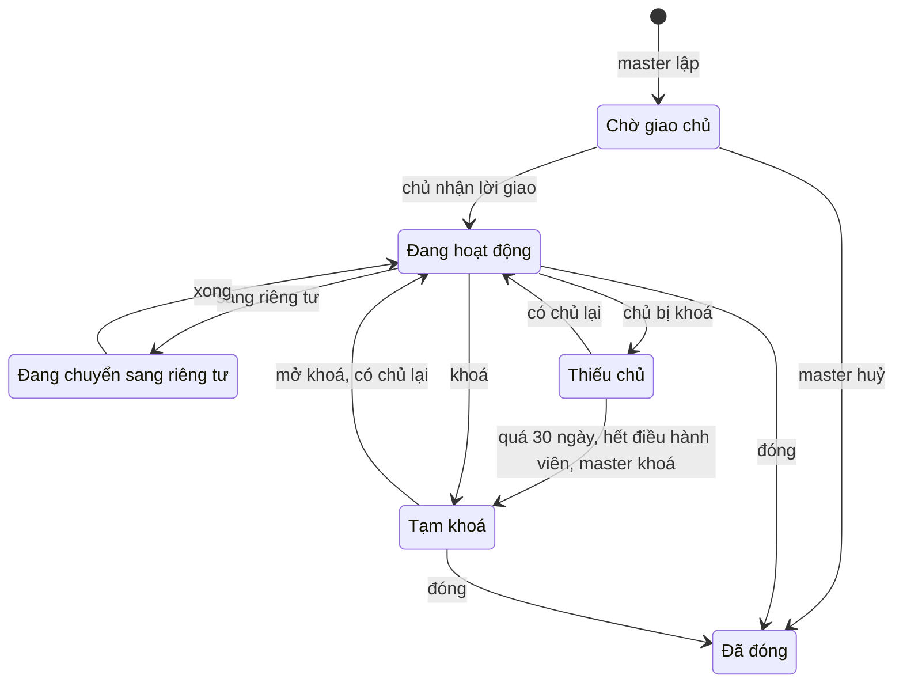
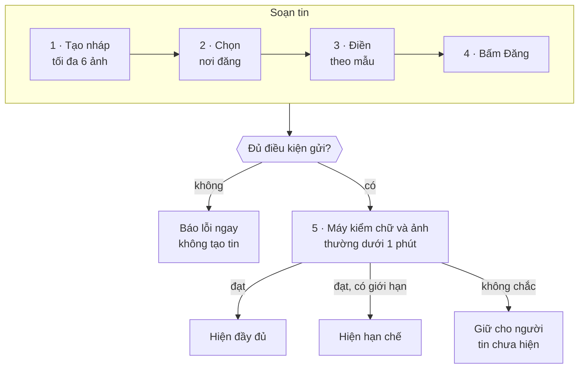
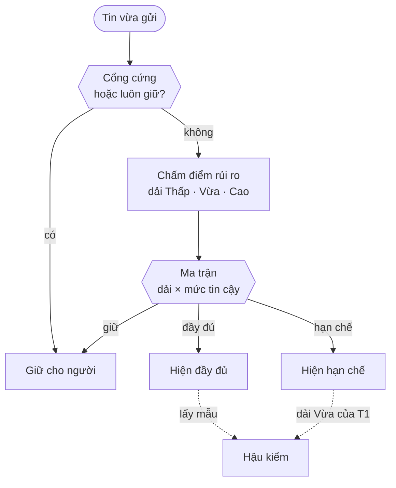
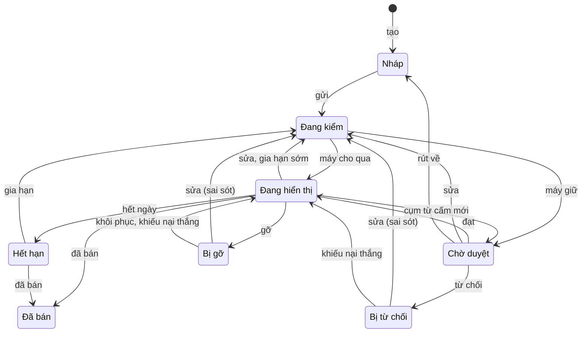

# Thiết kế hệ thống Ghim — bản chốt

**Sàn rao vặt Ghim · mọi tính năng và mọi luật, viết cho người không làm kỹ thuật**

|               |                                                                                                                                                                                                                             |
| ------------- | --------------------------------------------------------------------------------------------------------------------------------------------------------------------------------------------------------------------------- |
| **Ngày chốt** | 08/10/2026                                                                                                                                                                                                                  |
| **Dành cho**  | Chủ sản phẩm, khách hàng, người mới vào dự án, người kiểm thử, đội lập trình. Không cần biết lập trình để đọc; riêng phần 30 dành cho đội lập trình.                                                                        |
| **Thay cho**  | Mọi bản trước: `LUAT-NGHIEP-VU`, `DAC-TA-NGHIEP-VU-CHUAN`, `THIET-KE-HE-THONG-MOI` v1–v3, `THIET-KE-CHOT` bản sửa 1–5, cùng các bản rà soát. Đây là bản duy nhất còn hiệu lực.                                              |
| **Gộp từ**    | Bản thiết kế v3 (ba quyết định chốt của chủ sản phẩm) · hai lần rà soát, mỗi lần 21 vấn đề · quyết định ngày 08/10: staff là quyền trên tài khoản cá nhân, chỉ master lập nhóm, chặn lập nhiều tài khoản bằng dấu thiết bị. |
| **Cách đọc**  | Mỗi phần một chủ đề. Từ nào lạ thì tra phần 3. Mọi con số gom ở phần 28.                                                                                                                                                    |

---

## Mục lục

1. Những quyết định đã chốt
2. Hệ thống trong một trang
3. Từ điển
4. Chín nguyên tắc
5. Ai là ai
6. Ai được làm gì
7. Tài khoản
8. Một máy, nhiều tài khoản
9. Nhóm: lập nhóm, chế độ, vòng đời
10. Nhóm: vào nhóm, thành viên, huy hiệu, thiếu chủ, đóng nhóm
11. Danh mục
12. Đăng một tin
13. Máy duyệt: hai lối ra và cổng cứng
14. Máy duyệt: chấm điểm và ma trận quyết định
15. Mức hiển thị: đầy đủ và hạn chế
16. Người duyệt: hàng chờ và hạn xử
17. Người duyệt: một quyết định
18. Vòng đời một tin
19. Sửa, gia hạn, tạm ẩn, xoá tin
20. Mức tin cậy và hạn mức
21. Gậy
22. Khiếu nại, ân xá, gậy nghiêm trọng
23. Báo cáo vi phạm
24. Nhắn tin và thông báo
25. Ảnh và lưu trữ dữ liệu
26. Việc hệ thống tự làm
27. Những điều hệ thống cam kết
28. Bảng con số khởi đầu
29. Hoãn lại, còn mở, thứ tự xây
30. Phụ lục cho đội lập trình

---

## 1. Những quyết định đã chốt

| #   | Quyết định                                                                                                                                                                                                                              |
| --- | --------------------------------------------------------------------------------------------------------------------------------------------------------------------------------------------------------------------------------------- |
| 1   | **Máy duyệt trước.** Tin đạt chuẩn lên bảng ngay, không qua người. Máy không chắc thì **giữ cho người**. Quá hạn mà chưa ai xử thì **vẫn giữ**, không tự mở.                                                                            |
| 2   | **Máy không bao giờ từ chối, không bao giờ phạt.** Máy chỉ có hai lối ra: cho qua (hiển thị đầy đủ hoặc hạn chế), hoặc giữ cho người.                                                                                                   |
| 3   | **Sàn chung do master quản**, chia cho **staff theo danh mục**. Staff xử phần máy giữ lại và hậu kiểm.                                                                                                                                  |
| 4   | **Master toàn quyền.** Quyết định của master là cuối cùng; không có cơ chế kiểm soát master; mọi thao tác ghi nhật ký. **Đúng một master**, do đội kỹ thuật tạo một lần; không có luồng thay hay bỏ master trong app (chốt 10/10/2026). |
| 5   | **Staff là một quyền** master gắn lên tài khoản cá nhân của một người, không phải tài khoản riêng.                                                                                                                                      |
| 6   | **Không ai, trừ master, xử việc của chính mình** — tính cả tài khoản dùng chung thiết bị với mình.                                                                                                                                      |
| 7   | **Chỉ xác thực bằng email.** Không gửi SMS, số điện thoại không bắt buộc.                                                                                                                                                               |
| 8   | **Tài khoản mới chỉ được hiển thị hạn chế** ở nơi công khai, tới khi đủ 7 ngày tuổi và có một tin sạch.                                                                                                                                 |
| 9   | **Một máy tối đa 3 tài khoản đăng tin** trong 90 ngày. Từ tài khoản thứ 4, tin luôn chờ người duyệt — giữ lại chứ không chặn.                                                                                                           |
| 10  | **Chỉ master lập nhóm.**                                                                                                                                                                                                                |
| 11  | **Huy hiệu nhóm** chỉ cho thành viên đã được nhóm xét vào.                                                                                                                                                                              |
| 12  | **Phạt bằng gậy có hạn.** Mức tin cậy quyết định đăng được bao nhiêu và hiển thị rộng tới đâu.                                                                                                                                          |
| 13  | **Tối đa 6 ảnh** mỗi tin.                                                                                                                                                                                                               |
| 14  | **Xác minh giấy tờ là tính năng phụ**, không tham gia luồng chính.                                                                                                                                                                      |

---

## 2. Hệ thống trong một trang

**Ghim là một sàn rao vặt.** Người dùng đăng tin bán đồ, người khác xem và nhắn tin hỏi mua. Hệ thống nối người bán với người mua — không giữ tiền, không giao hàng, không bảo đảm chất lượng món đồ. Thứ hệ thống bảo đảm là: nội dung lên bảng đúng luật, và người vi phạm bị xử có lý do.

**Hai nơi để đăng tin**

| Nơi           | Là gì                                                 | Ai giữ trật tự                                           |
| ------------- | ----------------------------------------------------- | -------------------------------------------------------- |
| **Sàn chung** | Bảng tin cả nước, ai cũng xem được                    | Máy duyệt; staff theo danh mục và master xử phần máy giữ |
| **Nhóm**      | Bảng tin riêng của một trường, công ty, hay cộng đồng | Máy duyệt; chủ nhóm và điều hành viên xử phần máy giữ    |

**Hai cửa vào hệ thống**

- **App Ghim** trên điện thoại: người dùng mua bán, nhắn tin; chủ nhóm và điều hành viên quản lý nhóm ngay trong app.
- **Bàn vận hành** là trang web nội bộ: master và staff xử tin bị giữ, hậu kiểm, xử báo cáo, quản lý danh mục. Tách khỏi app để sửa công cụ quản lý không phải chờ phát hành lại app.

**Dịch vụ bên ngoài:** kho lưu ảnh, gửi thông báo lên điện thoại, gửi email, đăng nhập bằng Google; DeviceCheck của Apple thêm ở bản sau (phần 29). **Không dùng SMS.**

---

## 3. Từ điển

| Từ                        | Nghĩa                                                                                                                                                      |
| ------------------------- | ---------------------------------------------------------------------------------------------------------------------------------------------------------- |
| Tin đăng                  | Một món đồ được rao bán: ảnh, tiêu đề, mô tả, giá, khu vực.                                                                                                |
| Nháp                      | Tin đang soạn, chưa gửi. Ảnh chọn trong lúc soạn thuộc về nháp.                                                                                            |
| Phủ sóng                  | Tin được ai xem. Ba mức: **chỉ thành viên** nhóm · **nhóm công khai** (ai cũng đọc, nhưng nằm trong nhóm) · **sàn chung** (cả nước).                       |
| Mức hiển thị              | Tin đã lên bảng hiển thị **đầy đủ** (bảng tin, tìm kiếm, gợi ý, hồ sơ) hay **hạn chế** (chỉ tìm kiếm có từ khoá, hồ sơ người bán, đường link trực tiếp).   |
| Giữ cho người             | Máy không chắc, nên để tin chờ một người thật xem trước khi hiện.                                                                                          |
| Cổng cứng                 | Những trường hợp máy luôn giữ cho người, không cần chấm điểm.                                                                                              |
| Việc · hàng chờ           | Một **việc** là thứ cần người xử (tin bị giữ, báo cáo, khiếu nại…). Việc nằm trong **hàng chờ** của người có quyền xử. Mỗi tin có tối đa một việc đang mở. |
| Hậu kiểm                  | Người xem lại một ít tin đã lên bảng — do máy hoặc người duyệt khác cho lên — để biết có gì lọt không.                                                     |
| Sàn chung · Nhóm          | Hai nơi đăng tin (phần 2). Chỉ master lập nhóm.                                                                                                            |
| Người ngoài               | Người gửi tin vào một nhóm mà mình không phải thành viên.                                                                                                  |
| Huy hiệu nhóm             | Dòng "Thành viên nhóm X" trên tin sàn chung của một thành viên.                                                                                            |
| Master                    | Người quản lý cao nhất, toàn quyền. Đúng một người.                                                                                                        |
| Staff                     | Người được master gắn quyền xử tin sàn của một vài danh mục, trên chính tài khoản cá nhân của họ.                                                          |
| Chủ nhóm · Điều hành viên | Người chịu trách nhiệm một nhóm (đúng một người) · người chủ nhóm giao việc duyệt tin, quản lý thành viên.                                                 |
| Thiếu chủ nhóm            | Nhóm vừa mất chủ nhóm, chờ giao chủ mới, tối đa 30 ngày.                                                                                                   |
| Mức tin cậy               | T0, T1, T2, T3 của một người dùng; tính lại từ tuổi tài khoản, tin sạch và gậy.                                                                            |
| Tin sạch                  | Tin đã hiện ít nhất 7 ngày, hoặc đã bán sau ít nhất 2 ngày và có người nhắn hỏi mua; không bị gỡ vì vi phạm, không bị báo cáo đúng.                        |
| Hạn mức                   | Số tin tối đa một người được có cùng lúc (tin sống) và số lượt gửi mỗi giờ (nhịp gửi).                                                                     |
| Gậy                       | Án phạt có điểm và ngày hết hạn, do người thật ra khi xác nhận vi phạm.                                                                                    |
| Khiếu nại                 | Người nhận gậy xin xét lại, một lần.                                                                                                                       |
| Sai sót · Vi phạm         | Hai mức khi người duyệt từ chối hay gỡ. **Sai sót**: sửa lại là được, không bị gì. **Vi phạm**: phạm quy định sàn, kèm gậy.                                |
| Tạm ẩn                    | Tin bị giấu vì một lý do bên ngoài (nhóm bị khoá, danh mục tắt…). Hết lý do thì hiện lại nguyên như cũ. **Không phải án phạt.**                            |
| Dấu thiết bị              | Mã nhận ra chiếc điện thoại đang dùng app, để biết một máy có bao nhiêu tài khoản đăng tin. Chỉ dùng chống gian lận.                                       |
| Tạm giữ bằng chứng        | Dữ liệu dính tới một báo cáo, gậy hay khiếu nại đang mở không bị xoá hẳn, kể cả khi người dùng tự xoá.                                                     |

---

## 4. Chín nguyên tắc

Mọi luật ở các phần sau đều suy ra từ đây.

1. **Máy quyết phần chắc, người quyết phần máy không chắc.** Không có người đứng giữa tin đạt chuẩn và bảng tin. Phần máy giữ lại chờ người, có hạn xử.
2. **Quá hạn thì giữ, không mở.** Việc nào bảo vệ người mua mà không ai xử kịp thì giữ nguyên và đẩy lên cấp trên. Chỉ việc lấy mẫu hậu kiểm được tự huỷ khi quá hạn.
3. **Master toàn quyền.** Mọi luật ràng buộc người dùng, điều hành nhóm và staff. Master đứng ngoài; quyết định của master là cuối cùng và được ghi nhật ký.
4. **Không ai, trừ master, xử việc của chính mình** — tin mình đăng, báo cáo về mình, khiếu nại về gậy mình ra — kể cả qua tài khoản dùng chung thiết bị.
5. **Việc cần hai người thì phải là hai người khác nhau.** Người duyệt khác người đăng. Người xét khiếu nại khác người ra gậy (gậy thường, nặng do master ra thì master tự xem lại; gậy nghiêm trọng do một master ra thì master kia xét). Người xác nhận vi phạm khác người đề nghị.
6. **Mỗi tin có tối đa một việc đang mở.** Thêm lý do thì gộp vào việc đó. Không bao giờ có hai người xử một tin ra hai kết quả.
7. **Máy không phạt.** Máy cho qua hoặc giữ cho người. Mọi hình phạt do một người thật ra, có lý do, có ngày hết hạn (trừ gậy nghiêm trọng).
8. **Người dùng luôn biết mình đang ở đâu.** Bị giữ thì biết đang chờ người duyệt và chờ tới bao giờ; bị phạt thì biết ngày hết. Lỗi tự sửa được thì được giải thích cụ thể. Dấu hiệu gian lận thì nói ở mức chung — "tin cần kiểm tra an toàn thêm" — kèm thời gian chờ ước tính và nút liên hệ hỗ trợ có mã tra cứu: biết vì sao và tới bao giờ, nhưng không dạy cách lách.
9. **Tạm ẩn khác với bị phạt, và mọi dữ liệu cá nhân có hạn lưu.** Tin tạm ẩn vì lý do bên ngoài hiện lại đúng như cũ, không mất ngày. Không gì giữ mãi, trừ nhật ký quyết định — và nhật ký không chứa nội dung tin.

**Khi hai luật đụng nhau**, luật đứng trước thắng:

1. **An toàn pháp lý.**
2. **Không ai tự xử việc của mình** — chỉ master được.
3. **Máy không phạt.**
4. **Người dùng biết vì sao.**
5. **Sự tiện lợi.**

**Khác gì hệ thống đang chạy**

| Đang chạy                                                            | Hệ thống mới                                                                            |
| -------------------------------------------------------------------- | --------------------------------------------------------------------------------------- |
| Sàn chung chia ô danh mục × tỉnh × phường, mỗi ô một người phụ trách | Máy duyệt sàn chung; staff theo danh mục xử phần máy giữ; nhiều staff một danh mục được |
| Máy quét hàng chờ 2 phút một lần; ảnh không được kiểm                | Máy kiểm chữ và ảnh ngay khi gửi, xong trước khi tin hiện                               |
| Máy từ chối tin dính cụm cấm                                         | Máy không từ chối; không chắc thì giữ cho người                                         |
| Người có quyền duyệt tự duyệt được tin mình                          | Không ai (trừ master) xử việc của mình, kể cả qua tài khoản trùng thiết bị              |
| Bậc uy tín 0–2 cộng trừ theo từng lần duyệt                          | Mức tin cậy T0–T3 tính lại từ lịch sử; gậy có ngày hết hạn                              |
| "Đã ẩn" gộp cả bị phạt lẫn bị ảnh hưởng vì nhóm                      | Ba thứ riêng: trạng thái tin, cờ tạm ẩn, mức hiển thị có lý do                          |
| Bàn quản trị nằm trong app                                           | Bàn vận hành là trang web riêng                                                         |
| Không có luật lưu trữ dữ liệu                                        | Mỗi loại dữ liệu có hạn lưu                                                             |

---

## 5. Ai là ai

**Master**

- **Đúng một tài khoản master**, do đội kỹ thuật tạo trực tiếp một lần, không đăng ký qua app. Không có luồng thay hay bỏ master trong app; mất máy tạo mã thì đội kỹ thuật đặt lại hai lớp bằng công cụ chạy tay (chốt 10/10/2026).
- Bắt buộc đăng nhập hai lớp bằng ứng dụng tạo mã; tối đa 3 phiên đăng nhập cùng lúc.
- **Toàn quyền** trên mọi phần của hệ thống; quyết định là cuối cùng, không khiếu nại lên ai khác. Mọi thao tác **ghi** vào nhật ký (thao tác chỉ đọc và thao tác bị từ chối thì không); chỉ master đọc nhật ký.
- Tài khoản master không đăng tin, không vào nhóm. Người làm master muốn bán đồ thì dùng tài khoản cá nhân như mọi người.

**Staff**

- Không phải một loại tài khoản riêng. Staff là **một quyền master gắn lên tài khoản cá nhân** của một người. Staff vẫn đăng tin, nhắn tin, vào nhóm như mọi người dùng.
- Quyền theo **danh mục**: "xử tin sàn của Điện thoại và Máy tính". Một danh mục có thể có nhiều staff.
- Master có thể giao thêm ba việc toàn hệ thống: **hỗ trợ người dùng**, **xử báo cáo về người** (việc an toàn), **duyệt giấy tờ xác minh**.
- Tài khoản mang quyền staff bắt buộc đăng nhập hai lớp, tối đa 3 phiên.
- Tài khoản bị khoá hoặc đang có gậy thì **quyền staff tự treo**, việc đang nhận trả về hàng chờ. Hết gậy hay mở khoá thì master quyết có trả lại không.
- Tài khoản mang quyền staff bị xoá thì **quyền staff bị thu hẳn**, kể cả quyền đang treo: tài khoản đã xoá không quay lại được nên không có gì để treo chờ (11/10/2026).
- Quyền staff phải **tường minh và đầy đủ**: master gắn đúng danh mục và đúng việc toàn hệ thống, không có "mọi danh mục". Staff có thể chỉ mang việc toàn hệ thống mà không có danh mục nào. Chỉ gắn được cho tài khoản đang hoạt động và đã xác nhận email. Quyền đang treo vẫn là quyền staff: vẫn đòi hai lớp và trần 3 phiên (chốt 10/10/2026).

**Trong một nhóm**

- **Chủ nhóm**: đúng một người, do master giao; chuyển nhượng được, người nhận phải bấm đồng ý trong 14 ngày.
- **Điều hành viên**: chủ nhóm bổ nhiệm; phụ trách cả nhóm hoặc một lớp, một phòng ban.
- **Thành viên**: người đã vào nhóm.
- Giữ vai chủ nhóm hay điều hành viên cần **mức T1 trở lên và không có gậy nặng**. Nhận gậy nặng hoặc bị khoá tài khoản thì tạm mất vai tới khi gậy hết hoặc được mở khoá. Mức chỉ xét lúc **nhận** vai: tụt dưới T1 sau đó không làm mất vai (chốt 12/10/2026).

> **Vì sao staff là một quyền chứ không phải tài khoản riêng.** Mỗi người một tài khoản thì luật "không xử việc của mình" chỉ còn là phép so người duyệt có phải người đăng không. Khe hở còn lại — một người tự lập tài khoản thứ hai bằng email khác — được thu hẹp bằng dấu thiết bị (phần 8), nhật ký ghi tên người xử, và hậu kiểm quyết định của người duyệt (phần 16).

---

## 6. Ai được làm gì

Ô trống nghĩa là không. Mọi ô ✓ đều có một ngoại lệ chung: không ai, trừ master, xử việc của chính mình hay của tài khoản dùng chung thiết bị với mình — việc đó tự đi cho người kế tiếp (phần 16).

| Việc                                                                  | Khách | Người dùng | Điều hành viên                    | Chủ nhóm                | Staff (danh mục được giao)                                              | Master                                   |
| --------------------------------------------------------------------- | ----- | ---------- | --------------------------------- | ----------------------- | ----------------------------------------------------------------------- | ---------------------------------------- |
| Xem tin công khai, hồ sơ nhóm công khai                               | ✓     | ✓          | ✓                                 | ✓                       | ✓                                                                       | ✓                                        |
| Đăng, sửa, gia hạn tin của mình · nhắn tin · lưu tin · báo cáo        |       | ✓          | ✓                                 | ✓                       | ✓                                                                       | qua tài khoản cá nhân                    |
| Xử tin trong nhóm mà máy giữ                                          |       |            | ✓ phạm vi của mình                | ✓                       | khi nhóm hết người, hoặc danh mục đặt "tin nhóm do sàn duyệt" (phần 11) | ✓                                        |
| Từ chối, gỡ vì vi phạm trong nhóm                                     |       |            | không gậy, chuyển staff           | không gậy, chuyển staff | xác nhận → gậy                                                          | ✓                                        |
| Xử tin sàn mà máy giữ · gỡ, khôi phục tin sàn · hậu kiểm              |       |            |                                   |                         | ✓                                                                       | ✓                                        |
| Gỡ tin khỏi nhóm, gỡ huy hiệu nhóm mình                               |       |            | ✓                                 | ✓                       |                                                                         | ✓                                        |
| Duyệt đơn vào nhóm, mời, gỡ, cấm thành viên                           |       |            | ✓                                 | ✓                       |                                                                         | ✓                                        |
| Bổ nhiệm điều hành viên, sửa cài đặt, bật hiện tên nhóm, đóng nhóm    |       |            |                                   | ✓                       |                                                                         | ✓                                        |
| Xử báo cáo về một tin                                                 |       |            | tin nhóm, trừ lừa đảo và hàng cấm | như điều hành viên      | tin sàn; lừa đảo, hàng cấm cả trong nhóm                                | ✓                                        |
| Xử báo cáo về một người                                               |       |            |                                   |                         | nếu được giao việc an toàn                                              | ✓                                        |
| Xét khiếu nại về gậy                                                  |       |            |                                   |                         | gậy thường, nặng do staff khác ra; gậy nghiêm trọng chỉ ghi nhận xét    | ✓ cuối cùng; gậy nghiêm trọng chỉ master |
| Soạn · phát hành mẫu thông tin danh mục                               |       |            |                                   |                         | soạn                                                                    | phát hành                                |
| Lập nhóm, giao chủ nhóm, khoá nhóm                                    |       |            |                                   |                         |                                                                         | ✓                                        |
| Cấp, thu quyền staff · danh mục · cụm từ cấm · luật máy · bảng con số |       |            |                                   |                         |                                                                         | ✓                                        |
| Khoá tài khoản · ân xá · quyết gậy nghiêm trọng                       |       |            |                                   |                         |                                                                         | ✓                                        |

---

## 7. Tài khoản

**Đăng ký**

1. Nhập **email và mật khẩu**, rồi nhập mã xác nhận gửi về email — hoặc **đăng nhập bằng Google** (email coi như đã xác nhận).
2. Xong là tài khoản ở **mức T0** và đăng tin được ngay (phần 20).

- **Chỉ xác thực bằng email.** Hệ thống không gửi SMS.
- **Email dùng một lần bị chặn.** Danh sách miền lấy hạt giống từ một danh sách công khai do cộng đồng duy trì và tự cập nhật hằng tuần; master thêm miền mới hoặc bỏ miền bị liệt kê oan, và lượt cập nhật tự động không đụng tới phần master đã sửa. Chặn theo đuôi miền nên miền con cũng bị chặn. Bị chặn thì app nói thẳng lý do: đây là lỗi tự sửa được, không phải dấu hiệu gian lận.
- **Mỗi email chỉ một tài khoản.** Email được **chuẩn hoá** trước khi so và trước khi băm: chữ thường; bỏ phần sau dấu "+"; với Gmail bỏ dấu chấm và coi googlemail.com là gmail.com. Không chuẩn hoá thì thêm "+1" vào email là có ngay tài khoản mới.
- **Đăng ký chưa xác nhận không giữ được email.** Người đăng nhập Google bằng một email chỉ có đăng ký chưa xác nhận thì đăng ký dở bị xoá hẳn (cả mật khẩu và phiên) và Google tạo tài khoản mới. Không thế thì kẻ xấu đăng ký trước bằng email người khác, chờ chủ email vào bằng Google, rồi dùng chung tài khoản bằng mật khẩu của mình (chốt 15/10/2026).
- **Số điện thoại không bắt buộc.** Ai muốn người mua gọi được thì thêm vào hồ sơ; số không được xác thực và hiện kèm nhãn **"chưa xác minh"**.
- Chưa xác nhận email thì chưa đăng tin, chưa nhắn tin được.

**Mật khẩu và thiết bị đăng nhập**

- Mật khẩu dài **8–128 ký tự** và không nằm trong danh sách mật khẩu hay gặp đi kèm phần mềm. Đây là lỗi tự sửa được nên app nói rõ vì sao bị từ chối.
- **Quên mật khẩu:** nhận mã về email theo cùng luật với mã xác nhận; hệ thống trả lời giống hệt nhau dù email có tài khoản hay không, để không ai dò được email nào đã đăng ký. Đặt lại xong thì **mọi thiết bị phải đăng nhập lại**.
- **Đổi mật khẩu** khi đang đăng nhập cần mật khẩu cũ; các thiết bị khác bị đăng xuất, thiết bị đang dùng giữ nguyên.
- Đăng nhập quá số thiết bị cho phép thì **vẫn vào được**, thiết bị lâu không dùng nhất bị đăng xuất để nhường chỗ — người thật hiếm khi nhớ mình còn đăng nhập ở đâu, từ chối chỉ làm khó đúng người đó.
- Người dùng xem được danh sách thiết bị đang đăng nhập (tên thiết bị, lần dùng cuối) và đăng xuất từng cái hoặc tất cả trừ cái đang dùng. Thiết bị **30 ngày** không dùng thì tự hết phiên.

**Hồ sơ**

- Ai cũng xem được hồ sơ công khai: tên, ảnh đại diện, ngày tham gia, các tin đang bán.
- Tên hiển thị và ảnh đại diện qua cùng bộ lọc cụm từ cấm và kiểm ảnh như tin đăng. Không ai được đặt tên trùng tên của bộ phận quản lý ("Quản trị hệ thống").
- Ai thấy số điện thoại của mình bị người khác dùng thì báo cáo loại "sai thông tin".

**Đổi email:** phải xác nhận email mới; tối đa 1 lần mỗi 30 ngày. Gậy đang có đi theo cả email cũ lẫn email mới.

**Khoá:** master khoá tài khoản thì mọi tin của người đó tạm ẩn; mở khoá thì hiện lại như cũ.

**Xoá tài khoản**

- **Không xoá được** khi đang có gậy nặng, gậy nghiêm trọng, đang bị khoá, hoặc đang là chủ nhóm (phải chuyển chủ trước).
- **Có báo cáo đang mở vẫn xoá được** — giữ người dùng lại trái ý họ là sai, và dễ vướng quyền xoá dữ liệu cá nhân. Tài khoản ẩn 90 ngày; trong khoảng đó báo cáo vẫn được xử trên bản lưu. Báo cáo đúng thì gậy vẫn được ghi, đi theo email: xoá tài khoản không thoát được án.
- Xoá thì tin ẩn ngay; sau **90 ngày** xoá hẳn tin, ảnh, hồ sơ. Hội thoại chỉ ẩn phía người xoá — người kia vẫn đọc được.
- Trong 90 ngày chờ xoá hẳn, **email đó chưa đăng ký lại được**: tài khoản còn nằm đó dưới dạng ẩn, nên luật mỗi email một tài khoản vẫn áp; app báo ngày được đăng ký lại.
- **Đăng ký lại bằng cùng email** (sau chuẩn hoá) thì **kế thừa gậy còn hiệu lực**. Hệ thống chỉ giữ một **dấu băm** của email, tạo bằng một khoá bí mật nằm ngoài cơ sở dữ liệu, giữ 2 năm cùng gậy: đủ để nhận ra email khi có người đăng ký lại, nhưng không ai dò ngược ra được email gốc.

**Xác minh giấy tờ:** tính năng phụ. Người dùng tự nguyện nộp; master hoặc staff được giao việc này duyệt. Kết quả chỉ được lưu lại — **không** chặn ai dùng app, **không** ảnh hưởng đăng tin, mức tin cậy, hạn mức hay máy duyệt. Số giấy tờ không bao giờ hiện ra ngoài.

| Con số                                          | Giá trị                                        |
| ----------------------------------------------- | ---------------------------------------------- |
| Mã xác nhận email có hiệu lực                   | 10 phút                                        |
| Nhập sai mã quá … lần thì mã bị huỷ             | 5 lần                                          |
| Chờ giữa hai lần xin gửi lại mã                 | 60 giây                                        |
| Tài khoản đăng ký dở dang bị xoá sau            | 7 ngày                                         |
| Thiết bị đăng nhập cùng lúc tối đa              | 20 (người dùng) · 3 (staff, master)            |
| Mật khẩu                                        | 8–128 ký tự, không nằm trong danh sách hay gặp |
| Thiết bị không dùng tự hết phiên sau            | 30 ngày                                        |
| Danh sách email dùng một lần tự cập nhật        | hằng tuần                                      |
| Email của tài khoản đã xoá đăng ký lại được sau | 90 ngày                                        |

> **Chỉ xác thực bằng email: được gì, mất gì.** Được: đăng ký nhanh, không tốn tiền SMS. Mất: một người có nhiều email là có nhiều tài khoản. Hệ thống bù bằng bốn lớp: tài khoản mới chỉ hiển thị hạn chế (phần 15) · dấu thiết bị (phần 8) · gậy đi theo email (ở trên) · chặn email dùng một lần. Không lớp nào là tường tuyệt đối; cộng lại thì lập tài khoản mới không còn đáng công.

---

## 8. Một máy, nhiều tài khoản

**Vì sao cần.** Đăng ký chỉ cần email, nên một người có nhiều email là có nhiều tài khoản — để thoát gậy, tự duyệt tin mình, hay báo cáo hạ tin đối thủ. Không dùng SMS thì hệ thống cần một dấu hiệu khác cho biết các tài khoản này đang dùng chung một chiếc máy.

**Luật**

- Mỗi khi một tài khoản **đăng tin**, hệ thống ghi lại **dấu thiết bị** của máy đó.
- Đếm số tài khoản **đã đăng tin** từ máy đó trong **90 ngày** gần nhất. Không đếm mọi tài khoản từng đăng nhập: điện thoại cũ qua tay nhiều chủ, mà Ghim lại là nơi bán điện thoại cũ.
- **Ba tài khoản đầu** trên một máy đăng bình thường. Từ **tài khoản thứ 4**, mọi tin của tài khoản đó **luôn giữ cho người**. Không chặn đăng, không chặn cả máy — người dùng thật của máy không bị ảnh hưởng.
- Thứ tự tính theo **lần đăng tin đầu tiên** của mỗi tài khoản trên máy đó: tài khoản cũ quay lại đăng tin vẫn giữ chỗ của mình, tài khoản đến sau mới là bên nằm ngoài ba chỗ. Đánh dấu được tính lại ở mỗi lượt gửi tin, nên khi một tài khoản cũ quá 90 ngày không đăng tin, tài khoản thứ 4 tự hết bị đánh dấu.
- Tài khoản **bắt đầu đăng tin trên một máy sau khi** một tài khoản khác trên máy đó nhận gậy hay bị khoá: tin cũng luôn giữ cho người, tới khi gậy đó hết hạn hoặc tài khoản kia được mở khoá. Nhờ vậy không ai thoát gậy bằng cách lập tài khoản mới ngay trên máy mình, còn người nhà đã đăng tin từ trước thì không bị liên luỵ — với họ, việc dùng chung máy chỉ là một dấu hiệu rủi ro 30 điểm (phần 14).
- Người dùng thấy **câu chung của mọi dấu hiệu chống gian lận** (phần 13), không nhắc tới thiết bị — nói rõ chỉ giúp kẻ gian biết phải khôi phục cài đặt gốc. Câu có nút **liên hệ hỗ trợ kèm mã tra cứu**; hỗ trợ nhập mã là thấy lý do cụ thể. Mỗi đánh dấu có một mã riêng, cấp ngay lúc đánh dấu; mã không nói gì về loại đánh dấu hay thiết bị. Người vừa mua lại máy cũ được xác nhận thì thoát diện giữ.

**Dấu thiết bị còn dùng ở đâu**

- **Không ai xử việc của tài khoản dùng chung máy với mình** (phần 16). Staff lập tài khoản phụ trên máy mình để tự duyệt sẽ bị nhận ra.
- **Báo cáo hạ tin**: ngưỡng tạm ẩn đếm người báo trên **các máy khác nhau** (phần 23).
- Người duyệt thấy "tài khoản này dùng chung thiết bị với tài khoản X" khi xử việc, nhưng không thấy mã máy.

**Giới hạn kỹ thuật cần biết trước**

| Máy     | Dấu thiết bị bền tới đâu                                                                                                                                                                                                                                                                                                                                            |
| ------- | ------------------------------------------------------------------------------------------------------------------------------------------------------------------------------------------------------------------------------------------------------------------------------------------------------------------------------------------------------------------- |
| Android | Khá ổn: mã máy chỉ đổi khi khôi phục cài đặt gốc.                                                                                                                                                                                                                                                                                                                   |
| iPhone  | Yếu hơn: mã mà app đọc được đổi khi gỡ app rồi cài lại, nên cài lại app là bộ đếm về 0. Vì vậy dùng thêm tín hiệu phụ — địa chỉ mạng và thời điểm đăng ký — và, ở bản sau (phần 29), dùng **DeviceCheck** của Apple để đánh dấu những máy đã bị xác nhận lạm dụng. DeviceCheck chỉ lưu được vài bit: đủ để đánh dấu "máy này có vấn đề", không đủ để đếm tài khoản. |

**Quyền riêng tư:** dữ liệu thiết bị giữ **180 ngày** rồi xoá; chỉ dùng để chống gian lận, và ghi rõ như vậy trong chính sách quyền riêng tư.

> **Vì sao giữ lại chứ không chặn.** Chặn đăng tự động là máy phạt (trái nguyên tắc 7), và người bị chặn không biết tới bao giờ (trái nguyên tắc 8). Giữ lại thì người thật chỉ chờ lâu hơn một chút; còn kẻ lập nhiều tài khoản mất hẳn lợi thế, vì mọi tin của họ đều phải qua người.

---

## 9. Nhóm: lập nhóm, chế độ, vòng đời

**Lập nhóm**

- **Chỉ master lập nhóm.** Người dùng muốn có nhóm thì liên hệ bộ phận quản lý.
- Nhóm mới lập chưa ai vào được cho tới khi có **chủ nhóm**: master giao, người được giao bấm đồng ý.
- Bốn loại nhóm: trường học, công ty, cộng đồng, khác. Loại nhóm chỉ để chọn sẵn cài đặt lúc lập. Trường học và công ty có **đơn vị con** (lớp, phòng ban).

**Bốn chế độ**

| Chế độ                 | Ai tìm thấy nhóm                  | Vào bằng cách nào             | Huy hiệu trên tin sàn                                                |
| ---------------------- | --------------------------------- | ----------------------------- | -------------------------------------------------------------------- |
| Công khai · mở cửa     | Mọi người, qua tìm kiếm           | Bấm Tham gia là vào           | Không                                                                |
| Công khai · xét duyệt  | Mọi người, qua tìm kiếm           | Gửi đơn, điều hành viên duyệt | Có, cho người vào qua duyệt, lời mời, danh sách lớp hoặc master giao |
| Riêng tư · có mã       | Không tìm được; chỉ ai có mã nhóm | Nhập mã rồi gửi đơn           | Chỉ khi chủ nhóm bật "hiện tên nhóm trên tin sàn"                    |
| Riêng tư · chỉ lời mời | Không tìm được                    | Lời mời hoặc danh sách lớp    | Chỉ khi chủ nhóm bật "hiện tên nhóm trên tin sàn"                    |

"Riêng tư · mở cửa" không tồn tại: nhóm đã giấu mình thì không để ai lạ vào thẳng.

**Cài đặt khác**

- **Nhận tin người ngoài**: bật hay tắt, chỉ nhóm công khai có. Người ngoài chỉ đăng được ở mức "nhóm công khai", tin qua máy như mọi tin, mỗi người ngoài tối đa **2 tin sống** trong một nhóm. Chủ nhóm tắt giữa chừng thì tin người ngoài đã gửi **giữ nguyên** — chỉ không nhận tin người ngoài mới, gửi mới hay chuyển vào nhóm (chốt 12/10/2026).
- **Kiểu bảng tin**: dạng dòng hay dạng lưới, do chủ nhóm chọn.
- **Mô tả nhóm**: tối đa 1000 ký tự, chủ nhóm sửa (chốt 11/10/2026).
- **Tạm khoá** (master, kèm lý do — chỉ chủ nhóm và điều hành viên thấy lý do): không đăng, không vào nhóm; tin trong nhóm tạm ẩn, không mất ngày hiển thị; huy hiệu của nhóm ẩn theo; mở khoá thì hiện lại đúng như cũ. Trong lúc khoá nhóm chỉ đọc: không duyệt đơn, mời, gỡ, cấm, đổi cài đặt hay gửi thông báo của nhóm; chủ nhóm và master vẫn đóng được.

**Đổi chế độ**

- **Công khai → riêng tư**: tin "nhóm công khai" hạ về "chỉ thành viên" **trước**, xong mới đổi. Trong lúc chuyển, không ai đăng được tin mức "nhóm công khai". Tin của **người ngoài** rời khỏi nhóm — không phạt, không chiếm hạn mức — và người đăng có 30 ngày để chuyển lên sàn chung; "nhận tin người ngoài" tự tắt.
- **Riêng tư → công khai**: có hiệu lực ngay, mọi thành viên được báo cùng lúc — không gì của thành viên lộ thêm: danh sách thành viên vẫn kín, tin "chỉ thành viên" **giữ nguyên mức**, không tự công khai (chốt 11/10/2026).
- **Đổi cách vào hoặc công tắc hiện tên**: mọi huy hiệu trên tin sàn của nhóm được tính lại ngay. Xét duyệt → mở cửa: đơn đang chờ huỷ, người xin được báo (không tự duyệt — duyệt tự động sẽ trao huy hiệu mà không ai xét). Có mã → chỉ lời mời: mã huỷ, đơn đang chờ vẫn được xét. Nhóm vừa thành riêng tư thì "hiện tên nhóm trên tin sàn" tắt.

**Vòng đời nhóm**

_Master lập, giao chủ, khoá, mở khoá. Chủ nhóm hoặc master đổi chế độ và đóng nhóm. "Xong", "quá 30 ngày" và "có chủ lại" do hệ thống tự chuyển: nhóm khoá vì thiếu chủ hay hết điều hành viên tự mở khi có chủ dùng được; nhóm do master khoá chỉ master mở, và master không mở được nhóm chưa có chủ dùng được._

---

## 10. Nhóm: vào nhóm, thành viên, huy hiệu, thiếu chủ, đóng nhóm

**Vào nhóm** — xét theo thứ tự:

1. Người đã bị **cấm** khỏi nhóm thì không vào lại được.
2. Nhóm **mở cửa**: bấm Tham gia là vào ngay.
3. Nhóm **xét duyệt** hoặc **có mã**: gửi đơn; điều hành viên duyệt thì vào, từ chối thì người xin được báo. Đơn tự huỷ sau **21 ngày**. Bị từ chối thì **7 ngày** sau mới gửi lại; mỗi người tối đa **3 đơn** đang chờ.
4. Nhóm **chỉ lời mời**: cần lời mời còn hạn (**14 ngày**) hoặc có tên trong danh sách lớp.

Mã nhóm gồm 6 ký tự, đổi được khi bị lộ (chủ nhóm, master). Người xin rút được đơn đang chờ.

- **Lời mời** gửi bằng email của một tài khoản; trả lời như nhau dù email có tài khoản hay không, để không ai dò được email nào đã đăng ký. Điều hành viên đơn vị con chỉ mời vào đơn vị mình (chốt 11/10/2026).
- **Danh sách lớp**: chủ nhóm, điều hành viên cả nhóm nạp danh sách email, mỗi email kèm đơn vị tuỳ chọn; hệ thống chỉ giữ dấu băm của email đã chuẩn hoá. Người có tên vào thẳng ở mọi chế độ đang nhận người, tự vào đơn vị ghi kèm. Không báo lại cho quản trị email nào đã khớp tài khoản (chốt 11/10/2026).

**Thành viên**

- Hệ thống ghi lại **đường vào** của từng người: bấm tham gia · được duyệt · lời mời · danh sách lớp · master giao. Đường vào quyết định huy hiệu và không đổi về sau.
- **Đơn vị con**: thành viên được xếp vào một lớp hay phòng ban; tin của họ trong nhóm **tự gắn** đơn vị đó. Chỉ nhóm trường học, công ty có đơn vị. Chủ nhóm lập, đổi tên, xoá đơn vị trống; chủ và điều hành viên cả nhóm xếp người. Điều hành viên đơn vị con chỉ quản lý thành viên đơn vị mình (gỡ, cấm, mời, gửi thông báo cho đơn vị) và không duyệt đơn (chốt 11/10/2026).
- **Điều hành viên không xử nhau**: điều hành viên không gỡ, cấm điều hành viên khác hay chủ nhóm — chủ nhóm bãi nhiệm trước. Cấm được cả người chưa từng vào nhóm; chủ nhóm, điều hành viên cả nhóm, master gỡ cấm được (chốt 11/10/2026).
- **Danh sách thành viên** chỉ chủ nhóm và điều hành viên xem được, ở mọi chế độ.
- **Rời nhóm**: tự rời (vào lại theo cách vào của nhóm) · bị gỡ (vào lại như người mới) · bị cấm (không vào lại, không gửi tin vào nhóm) · cựu thành viên (học sinh ra trường, theo năm học). Khi rời, bị gỡ, bị cấm: tin "chỉ thành viên" của người đó trong nhóm tạm ẩn, huy hiệu trên tin sàn của họ tự gỡ, việc máy giữ trong nhóm của họ bị huỷ. Hội thoại đã mở vẫn tiếp tục.
  - Tin **"nhóm công khai"** của người vừa rời, bị gỡ: lúc rời nhóm đang **tắt** nhận tin người ngoài thì tạm ẩn như tin "chỉ thành viên"; đang **bật** thì giữ nguyên, thành tin người ngoài. Xét đúng lúc rời — chủ nhóm bật lại sau đó không tự hiện tin đã ẩn, vì không gì tự lộ ra cho nhiều người hơn (chốt 12/10/2026).
  - **Bị cấm** thì **mọi** tin của người đó trong nhóm tạm ẩn, ở mọi mức — kể cả người ngoài chưa từng vào nhóm. Trong lúc bị cấm, ngày hiển thị của các tin đó **dừng**. Gỡ cấm chỉ gỡ lý do "bị cấm": tin nào còn lý do khác (vd tin "chỉ thành viên" chờ người đó vào lại nhóm) thì vẫn ẩn, và ngày vẫn dừng tới khi người đó vào lại nhóm (chốt 12/10/2026).
  - **Ngày hiển thị của tin bị ẩn khi rời nhóm**: tự rời thì vẫn trôi — người đăng tự chọn; bị gỡ hay bị cấm thì **dừng** — việc của nhóm, không do người đăng (chốt 12/10/2026).

**Huy hiệu nhóm**

- Dòng **"Thành viên THPT Lê Quý Đôn"** trên tin sàn chung của một thành viên; người đăng tự chọn có gắn hay không.
- **Chỉ thành viên vào bằng đường được xét** — được duyệt, lời mời, danh sách lớp, master giao — mới có huy hiệu, và chỉ ở nhóm công khai có xét duyệt hoặc nhóm riêng tư đã bật hiện tên. Người vào bằng bấm tham gia **không bao giờ** có huy hiệu, kể cả khi nhóm đổi sang có duyệt sau đó.
- Huy hiệu không làm tin được duyệt dễ hơn. Nhóm gỡ được huy hiệu của mình khỏi một tin, nhưng **không gỡ được tin sàn** — đó là việc của staff. Mỗi tin mang **tối đa 1 huy hiệu**. Huy hiệu nhóm đã gỡ khỏi một tin thì người đăng không gắn lại lên tin đó; nhóm bật lại "hiện tên nhóm" thì huy hiệu đã tự gỡ không tự quay lại — người đăng đủ quyền thì tự gắn lại (chốt 12/10/2026). Người ngoài bấm vào huy hiệu nhóm riêng tư chỉ thấy tên nhóm.

> **Vì sao người vào nhóm mở không có huy hiệu.** Ai bấm Tham gia cũng vào được, nên huy hiệu đó không chứng minh gì. Kẻ lừa đảo chỉ cần vào nhóm mở của một trường hay công ty là có ngay một dòng chữ khiến người mua tin rằng họ thuộc tổ chức đó.

**Giao và chuyển chủ nhóm** (chốt 11/10/2026)

- Master giao chủ bằng một **lời giao có hạn 14 ngày**; hết hạn thì nhóm vẫn như cũ, master giao lại.
- Chủ nhóm chuyển chủ cho **một thành viên** đủ điều kiện nhận vai, huỷ được lời chuyển đang chờ. Người nhận đồng ý thì chủ cũ thành **thành viên thường** — chủ mới bổ nhiệm lại nếu muốn.
- Master giao chủ mới cho nhóm đang có chủ mà không cần chủ cũ đồng ý; chủ cũ thành thành viên thường.

**Thiếu chủ nhóm**

- Chủ nhóm phải chuyển chủ trước khi rời nhóm hay xoá tài khoản. Nên nhóm chỉ mất chủ khi **tài khoản chủ nhóm bị khoá** hoặc chủ nhóm nhận gậy nặng.
- Khi đó nhóm sang trạng thái **thiếu chủ**: hệ thống đề cử điều hành viên cấp cả nhóm nhận vai sớm nhất (không có ai cấp cả nhóm thì điều hành viên đơn vị con nhận vai sớm nhất); master xác nhận bằng một lời giao chủ — cho người được đề cử hay một thành viên khác — và người đó bấm đồng ý. Trong lúc chờ, điều hành viên tiếp tục việc hằng ngày; không ai trong nhóm đổi được cài đặt hay bổ nhiệm người mới — master thì được.
- Chủ cũ được mở khoá trước khi có chủ mới thì nhóm trở lại với chủ cũ. Quá **30 ngày** chưa có chủ thì nhóm tạm khoá. Nhóm **không còn điều hành viên** nào ở mọi cấp thì tạm khoá ngay. Nhóm khoá vì hai lý do này tự mở khi có chủ dùng được.

**Đóng nhóm** — chủ nhóm hoặc master đóng (master đóng được cả nhóm chưa có chủ); đóng là vĩnh viễn, muốn có lại thì lập nhóm mới.

| Thứ                                         | Khi nhóm đóng                                                                                                                                                                                                                       |
| ------------------------------------------- | ----------------------------------------------------------------------------------------------------------------------------------------------------------------------------------------------------------------------------------- |
| Tin trong nhóm                              | Rời bảng ngay, không tính hạn mức. Người đăng có 30 ngày để chuyển tin lên sàn chung — tạo một **tin mới** (bản sao nội dung và ảnh, 30 ngày hiển thị và vị trí mới), qua máy như tin mới, mỗi tin chuyển một lần (chốt 12/10/2026) |
| Huy hiệu trên tin sàn                       | Tự gỡ                                                                                                                                                                                                                               |
| Đơn xin vào, lời mời, lời giao chủ, mã nhóm | Huỷ hết; báo người xin, người được mời; mọi thành viên được báo nhóm đã đóng                                                                                                                                                        |
| Việc đang chờ của nhóm                      | Huỷ; báo cáo lừa đảo, hàng cấm vốn ở chỗ staff nên vẫn được xử                                                                                                                                                                      |
| Dữ liệu                                     | Xoá hẳn sau 90 ngày, trừ dữ liệu đang tạm giữ làm bằng chứng                                                                                                                                                                        |

---

## 11. Danh mục

Danh mục do master quản lý. Mỗi danh mục có các cài đặt:

| Cài đặt                     | Ý nghĩa                                                                                                                                                      |
| --------------------------- | ------------------------------------------------------------------------------------------------------------------------------------------------------------ |
| Mẫu thông tin               | Danh mục cần hỏi thêm gì (điện thoại: hãng, dung lượng; xe máy: năm sản xuất, số km). Người đăng điền theo mẫu, người mua lọc theo đó.                       |
| Trần giá                    | Giá trên trần thì máy luôn giữ cho người.                                                                                                                    |
| Giá tham chiếu              | Mức giá thường thấy, dùng để nhận ra giá bất thường và đồ cho tặng đáng ngờ.                                                                                 |
| Mức rủi ro                  | Thấp, vừa, cao. Mức cao cộng 20 điểm rủi ro cho mọi tin của danh mục (phần 14).                                                                              |
| Luôn duyệt tay              | Bật thì **mọi tin của danh mục đều giữ cho người**, ở mọi mức tin cậy. Dùng cho rủi ro pháp lý — như thú cưng có loài cấm buôn bán.                          |
| Tin nhóm bị giữ do ai duyệt | **Nhóm** (điều hành viên) hoặc **sàn** (staff danh mục). Mặc định: nhóm. Danh mục luôn duyệt tay vì lý do pháp lý đặt "sàn" — kể cả tin trong nhóm riêng tư. |

| Ví dụ      | Trần giá  | Rủi ro | Luôn duyệt tay                                       | Tin nhóm bị giữ do |
| ---------- | --------- | ------ | ---------------------------------------------------- | ------------------ |
| Quần áo    | 5 triệu   | Thấp   | Không                                                | Nhóm               |
| Điện thoại | 60 triệu  | Vừa    | Không                                                | Nhóm               |
| Xe máy     | 300 triệu | Vừa    | Không                                                | Nhóm               |
| Thú cưng   | 50 triệu  | Cao    | **Có** — loài cấm buôn bán máy không nhận ra qua ảnh | **Sàn**            |

_Các con số chỉ để minh hoạ; master đặt giá trị thật._

> **Vì sao tách "luôn duyệt tay" khỏi "rủi ro cao".** Rủi ro pháp lý là của cả sàn, không phải của nhóm — và nhóm kín chính là nơi hàng cấm dễ trốn nhất, nên tin nhóm của danh mục đó đi staff. Danh mục chỉ "rủi ro cao" thì bị cộng điểm và vẫn để nhóm tự xử. Mỗi tin vẫn chỉ vào đúng một hàng chờ.

- **Bật, tắt, không xoá.** Thôi dùng thì tắt: tin trong danh mục tạm ẩn — không chiếm hạn mức, không mất ngày — và không ai đăng mới được. Người đăng được **đổi tin sang danh mục khác**; tin qua máy lại.
- **Mẫu thông tin**: staff phụ trách danh mục soạn, master phát hành. Tin đã đăng giữ nguyên mẫu lúc đăng. Tên một mục thông tin không bao giờ đổi sau khi phát hành; nhãn hiển thị thì đổi được.
- **Khu vực**: 34 tỉnh, thành và 3.321 phường, xã sau sáp nhập; tìm được bằng tên cũ. Khu vực dùng để lọc và tìm đồ gần mình, không quyết định ai duyệt. Tin lên sàn chung bắt buộc có tỉnh và phường; tin trong nhóm thì tuỳ.
- **Giá**: số nguyên từ 0 trở lên, đơn vị đồng. **Giá 0 nghĩa là cho tặng**; app hiện "Miễn phí".
- **Danh mục phẳng**, không có cấp cha / con. Tên danh mục đổi được, mã danh mục không đổi (chốt 10/10/2026).
- **Trần giá và giá tham chiếu là tuỳ chọn**: không đặt trần nghĩa là danh mục không có trần; đặt cả hai thì giá tham chiếu không vượt trần. Mức rủi ro mặc định thấp, luôn duyệt tay mặc định tắt.
- **Cài đặt cho máy duyệt không công khai** (nguyên tắc 8): app chỉ đọc tên danh mục và mẫu thông tin; trần giá, giá tham chiếu, mức rủi ro, luôn duyệt tay, ai duyệt tin nhóm chỉ bàn vận hành thấy. Mỗi lần đổi cài đặt là một phiên bản cài đặt mới của danh mục, để kết quả máy ghi lại phiên bản đã dùng (cam kết 33).
- **Mẫu thông tin**: mỗi mục có tên (không đổi và không dùng lại cho mục khác kiểu), nhãn, kiểu (chữ, số, chọn một, chọn nhiều) và cờ bắt buộc; bản sau bỏ được mục. Tin đăng theo phiên bản cũ hiện nhãn của phiên bản đó, và sửa tin thì điền theo đúng phiên bản tin đang mang (chốt 12/10/2026). Mỗi danh mục một bản nháp chung cho staff phụ trách và master; chỉ master phát hành hoặc bỏ bản nháp. Danh mục ban đầu do master nhập qua bàn vận hành, không có sẵn.
- **Khu vực**: mã đơn vị lấy theo mã chính thức; tìm bỏ dấu, không phân biệt hoa thường, không sửa lỗi chính tả. Tên cũ cấp tỉnh có sẵn; tên cũ cấp phường bổ sung dần theo dữ liệu.

---

## 12. Đăng một tin

**Chọn nơi đăng — bắt buộc**

| Chọn           | Ai xem được                                  | Máy giữ thì ai xử                                                                  |
| -------------- | -------------------------------------------- | ---------------------------------------------------------------------------------- |
| Sàn chung      | Mọi người, cả nước                           | Staff danh mục, master                                                             |
| Nhóm công khai | Mọi người, nhưng chỉ nằm trong bảng tin nhóm | Điều hành viên nhóm — trừ danh mục đặt "tin nhóm do sàn duyệt" thì staff (phần 11) |
| Chỉ thành viên | Thành viên nhóm                              | Như trên                                                                           |

- Hệ thống **không đoán** nơi đăng. Đang xem bảng tin nhóm mà bấm Đăng thì app gợi ý, nhưng người đăng vẫn phải chọn.
- Đăng trong nhóm thì phải chọn nhóm; nhóm có đơn vị con thì tin tự gắn đơn vị của người đăng. Đăng sàn chung thì không cần chọn nhóm — trừ khi muốn gắn huy hiệu.
- **Người ngoài** chỉ gửi được vào nhóm công khai có bật nhận tin người ngoài, ở mức "nhóm công khai". Nhóm riêng tư không có mức "nhóm công khai".
- **Tối đa 6 ảnh**, ảnh đầu là ảnh bìa. Gửi tin bắt buộc có **tiêu đề, giá và ít nhất 1 ảnh**; mô tả không bắt buộc (chốt 12/10/2026).
- Bấm Đăng hai lần do mạng chậm cũng chỉ ra một tin — lần bấm sau nhận lại đúng tin của lần đầu, không báo lỗi (chốt 12/10/2026).
- **Điều kiện gửi**: còn chỗ trong hạn mức tin sống và nhịp gửi · không đang trong thời gian chờ · danh mục đang bật · đúng tư cách trong nhóm · có tỉnh và phường nếu lên sàn chung. Thiếu điều kiện nào thì báo lỗi ngay, kèm lý do và lúc được gửi lại; không tin nào được tạo.

> **Ví dụ — chị Lan bán xe đạp.** Chị Lan (mức T2) là thành viên nhóm Công ty ABC, một nhóm xét duyệt; chị vào nhóm qua đơn được duyệt. Chị chụp 3 ảnh, chọn **Sàn chung**, gắn huy hiệu "Thành viên Công ty ABC", điền theo mẫu của danh mục Xe đạp, đặt giá 2,5 triệu, chọn phường Bến Thành, bấm Đăng. Máy kiểm chữ và ảnh trong khoảng nửa phút: không cổng cứng, điểm rủi ro 0 → **tin hiện đầy đủ**.

---

## 13. Máy duyệt: hai lối ra và cổng cứng

**Hai lối ra, không có "từ chối".** Máy chỉ **cho qua** (hiển thị đầy đủ hoặc hạn chế) hoặc **giữ cho người**. Máy không trả tin về, không ra gậy, không hạ mức tin cậy. **Không chắc thì giữ**: dịch vụ chấm điểm lỗi, ảnh quá 5 phút chưa có kết quả — đều là giữ, không bao giờ là cho qua.

**Luôn giữ cho người, không cần chấm điểm**

- **Cổng cứng**: cụm từ cấm mức chắc · ảnh nhạy cảm · ảnh trùng với tin của tài khoản khác (trừ ảnh mẫu của hãng trong danh sách trắng do staff nuôi) · giá vượt trần danh mục.
- Danh mục bật **luôn duyệt tay** (phần 11).
- Tài khoản từ thứ 4 trên một máy, hoặc bắt đầu đăng trên máy sau khi tài khoản khác ở đó nhận gậy (phần 8).
- Tin luôn giữ vẫn được **chấm đủ điểm** để người duyệt thấy hết. Cổng cứng **chạy thử được, không tắt được** (chốt 12/10/2026).

**Dò cổng cứng.** Dính cổng cứng **3 lần trong 24 giờ** thì phải chờ 24 giờ mới gửi tin tiếp. Đây là thời gian chờ, **không phải gậy**. Đếm theo lượt qua máy — một lượt trúng mấy cổng cũng là một lần, gửi lại sau khi sửa cũng đếm; thời gian chờ chỉ chặn **tin mới** (gửi nháp, chuyển tin lên sàn chung), sửa và gia hạn tin đang có vẫn được (chốt 12/10/2026).

**Cụm từ cấm**

- Hai mức: **chắc** (cổng cứng) và **mơ hồ** (cộng điểm rủi ro).
- Chỉ nhận **cụm hai chữ trở lên** như "bán súng", không nhận từ đơn: "súng" bỏ dấu thành "sung", trùng "bổ sung", "quả sung" — người bán bình thường sẽ bị giữ hàng loạt.
- So theo **ranh giới chữ**, không phân biệt dấu; chữ cái bị tách rời ("b á n s ú n g") được ghép lại. Mỗi cụm có danh sách ngoại lệ.
- Cụm mới **chạy thử 7 ngày** (chấm nhưng không đổi kết quả) rồi mới bật. Khi bật thật, hệ thống quét lại tin đang hiện; tin chứa cụm đó bị **rút về chờ người duyệt** (mũi tên Đang hiển thị → Chờ duyệt, phần 18) — không bị từ chối thẳng. Chốt 12/10/2026: master bật sớm được nếu ghi lý do (vào nhật ký); bật thật cụm mơ hồ không quét lại; lượt quét chỉ rút tin đang hiển thị — tin đã bán, hết hạn để nguyên, tin bị rút về vẫn trôi ngày hiển thị; nhiều cụm mơ hồ cộng điểm một lần.
- Cùng bộ lọc áp cho tin nhắn, tên hiển thị. Tên trúng cụm mức chắc hiện với người khác là "Người dùng Ghim", chủ tài khoản thấy tên mình kèm lời nhắc đổi; cụm mơ hồ không áp cho tên (chốt 12/10/2026).

**Ảnh kiểm xong trước khi tin hiện.** Chữ chấm ngay khi gửi; ảnh chấm song song, thường xong dưới một phút. Tin chỉ hiện khi có kết quả cho cả chữ lẫn mọi ảnh. Không có khoảng trống nào để ảnh xấu hiện công khai.

**Giải thích cho người đăng**

- Lỗi tự sửa được — giá lệch, giá vượt trần, sai danh mục, số điện thoại trong mô tả — được nói rõ bằng câu dễ hiểu, kèm việc làm được ngay. Ví dụ: _"Giá của tin lệch xa mức thường thấy trong danh mục này. Kiểm tra lại đơn vị (đồng) và số 0."_
- Dấu hiệu gian lận — cụm từ cấm, ảnh trùng, thiết bị, đăng dồn — dùng **một câu chung** gồm ba phần: lý do ở mức nhóm (_"Tin cần kiểm tra an toàn thêm"_), thời gian chờ ước tính, và nút **liên hệ hỗ trợ kèm mã tra cứu**. Hỗ trợ nhập mã là thấy lý do cụ thể và gỡ được khi đúng là nhầm (vd người mua lại máy cũ). Không nêu tín hiệu nào, để không dạy cách lách. Dấu hiệu khác (gõ bừa, giá 0 ở danh mục giá trị cao, trùng tin của mình, bị giữ nhiều, tài khoản mới, danh mục rủi ro cao) chỉ nhận câu chờ. Tin vừa có lỗi tự sửa được vừa có dấu hiệu gian lận thì được nói phần tự sửa được, kèm câu chung. Mỗi lần giữ một mã tra cứu; thời gian chờ ước tính là hạn của hàng máy giữ; hỗ trợ chỉ gỡ đánh dấu theo thiết bị (chốt 12/10/2026).

**Luật có phiên bản.** Mỗi luật có mã, trọng số, chế độ bật · chạy thử · tắt, và chỉnh riêng được theo danh mục. Luật mới chạy thử trước. Hệ thống đo **tỉ lệ tin máy giữ mà người cho qua** theo từng luật; cao là máy quá tay, master hạ trọng số.

---

## 14. Máy duyệt: chấm điểm và ma trận quyết định

| Dấu hiệu                            | Máy nhìn thấy gì                                                                                                                                                     | Điểm |
| ----------------------------------- | -------------------------------------------------------------------------------------------------------------------------------------------------------------------- | ---- |
| Chữ như gõ bừa                      | Phần lớn tiêu đề, mô tả không phải chữ có nghĩa                                                                                                                      | 30   |
| Giá 0 ở danh mục giá trị cao        | Cho tặng trong danh mục có giá tham chiếu cao (mặc định từ 2 triệu)                                                                                                  | 30   |
| Trùng thiết bị với tài khoản có gậy | Dùng chung máy với tài khoản đang có gậy hoặc bị khoá, xét 90 ngày (trường hợp chưa thuộc diện luôn giữ ở phần 8)                                                    | 30   |
| Cụm từ cấm mức mơ hồ                | Trúng một cụm trong danh sách "mơ hồ"                                                                                                                                | 25   |
| Giá bất thường                      | Ngoài khoảng từ nửa phân vị 10 tới gấp đôi phân vị 90 của giá tin cùng danh mục trong 90 ngày; cần ít nhất 30 tin để so, thiếu thì không xét. Giá 0 không tính ở đây | 25   |
| Liên hệ ngoài sàn                   | Số điện thoại, Zalo, đường link nằm trong **mô tả**                                                                                                                  | 20   |
| Trùng tin của chính mình            | Gần như y hệt một tin khác của mình, kể cả tin đã xoá, hết hạn trong 30 ngày. Tin mới giữ vị trí của tin cũ, không được đẩy lên đầu                                  | 20   |
| Đăng dồn                            | Hơn 10 lượt gửi trong 24 giờ ở T0–T1, hơn 30 ở T2–T3                                                                                                                 | 20   |
| Danh mục rủi ro cao                 | Do master đặt                                                                                                                                                        | 20   |
| Bị giữ nhiều                        | Từ 3 lần máy giữ trong 7 ngày vì điểm hay cổng cứng (không đếm lỗi máy, quá giờ, luôn duyệt tay, đánh dấu thiết bị)                                                  | 15   |
| Sai danh mục                        | Máy suy ra danh mục thật khác danh mục đã chọn; nếu suy ra danh mục rủi ro cao hay luôn duyệt tay thì áp luật của danh mục đó                                        | 15   |
| Tài khoản mới                       | Dưới 3 ngày tuổi                                                                                                                                                     | 10   |

**Dải rủi ro** (ngưỡng chỉnh được theo danh mục): **Thấp** dưới 30 · **Vừa** 30–59 · **Cao** từ 60.

**Ma trận quyết định**

| Mức tin cậy                        | Dải Thấp                                                     | Dải Vừa                  | Dải Cao       |
| ---------------------------------- | ------------------------------------------------------------ | ------------------------ | ------------- |
| **T0** — mới                       | Trong nhóm "chỉ thành viên": đầy đủ · Nơi công khai: hạn chế | Giữ cho người            | Giữ cho người |
| **T1** — đã quen                   | Đầy đủ                                                       | Hạn chế, chờ hậu kiểm    | Giữ cho người |
| **T2** — tin cậy                   | Đầy đủ                                                       | Đầy đủ, vào mẫu hậu kiểm | Giữ cho người |
| **T3** — uy tín                    | Đầy đủ                                                       | Đầy đủ, vào mẫu hậu kiểm | Giữ cho người |
| **Có gậy còn hiệu lực** (trần T1)  | Hạn chế                                                      | Giữ cho người            | Giữ cho người |
| Danh mục luôn duyệt tay            | Giữ cho người, mọi mức, mọi dải                              |                          |               |
| Cổng cứng · luôn giữ theo thiết bị | Giữ cho người, mọi mức                                       |                          |               |
| Đang thời gian chờ                 | Không gửi được tin mới                                       |                          |               |

> **Vì sao T3 cũng bị giữ ở dải Cao.** Tài khoản uy tín bị chiếm là kịch bản đắt nhất: người mua tin nó nhất. Một người thật xem trong 24 giờ; người bán sửa được ngay trong lúc chờ, sửa thì qua máy lại, máy cho qua thì việc tự huỷ.

**Ba ví dụ**

| Tin                                                             | Dấu hiệu                                             | Điểm         | Kết quả                                                                     |
| --------------------------------------------------------------- | ---------------------------------------------------- | ------------ | --------------------------------------------------------------------------- |
| A. Tai nghe 1,2 triệu, tài khoản T2                             | Không có                                             | 0            | Hiện đầy đủ                                                                 |
| B. Tài khoản T0 2 ngày tuổi, mô tả ghi số Zalo, đăng sàn chung  | Tài khoản mới 10 · liên hệ ngoài sàn 20              | 30 — dải Vừa | Giữ cho người; người đăng được nhắc thêm số vào hồ sơ thay vì ghi vào mô tả |
| C. iPhone 15 giá 2 triệu, mô tả lộn xộn, ghi Zalo, tài khoản T1 | Giá bất thường 25 · gõ bừa 30 · liên hệ ngoài sàn 20 | 75 — dải Cao | Giữ cho người                                                               |

---

## 15. Mức hiển thị: đầy đủ và hạn chế

| Mức         | Tin xuất hiện ở đâu                                                                                 |
| ----------- | --------------------------------------------------------------------------------------------------- |
| **Đầy đủ**  | Bảng tin, tìm kiếm, gợi ý, hồ sơ người bán                                                          |
| **Hạn chế** | Chỉ tìm kiếm có từ khoá, hồ sơ người bán, đường link trực tiếp. Không lên bảng tin, không vào gợi ý |

Tin hạn chế khi còn **ít nhất một lý do**. Mỗi lý do đặt và gỡ độc lập, nên gỡ một lý do không mở nhầm tin còn lý do khác.

| Lý do hạn chế     | Đặt khi                                                                                                                         | Gỡ khi                                                                                                        |
| ----------------- | ------------------------------------------------------------------------------------------------------------------------------- | ------------------------------------------------------------------------------------------------------------- |
| **Máy**           | T1 đăng tin ở dải Vừa; lưới an toàn khi tin đang hiện thiếu kết quả ảnh                                                         | Người hậu kiểm cho đạt, hoặc lượt qua máy sau khi sửa cho hiện đầy đủ (chốt 12/10/2026); không tự gỡ theo giờ |
| **Tài khoản mới** | T0 đăng ra nơi công khai (sàn chung, nhóm công khai)                                                                            | Lên T1, hoặc tin thu hẹp về "chỉ thành viên" (chốt 12/10/2026)                                                |
| **Gậy**           | Tin mới khi người bán đang có gậy; **mọi tin đang hiện** khi điểm gậy chạm 2; tin hiện lại sau tạm ẩn khi người bán đang có gậy | Điểm gậy về 0 (tin áp ở mốc 2 thì khi về dưới 2)                                                              |

> **Vì sao có mức hạn chế.** Nó cho tin của người chưa quen được lên mà không cần người duyệt, nhưng chỉ người chủ động tìm mới thấy. Đội duyệt còn mỏng không phải xem từng tin, còn kẻ lập tài khoản mới hàng loạt thì không được đưa tin lên trước mắt người mua.

---

## 16. Người duyệt: hàng chờ và hạn xử

| Hàng | Việc                                                     | Ai xử                                                                                                                                     | Hạn    | Quá hạn thì                                                                                                   |
| ---- | -------------------------------------------------------- | ----------------------------------------------------------------------------------------------------------------------------------------- | ------ | ------------------------------------------------------------------------------------------------------------- |
| 0    | **Máy giữ** — tin chưa hiện                              | Tin sàn: staff danh mục · tin nhóm: điều hành viên, nhóm hết người thì staff; danh mục đặt "tin nhóm do sàn duyệt" thì staff              | 24 giờ | Chuyển master; tin vẫn giữ                                                                                    |
| 1    | **Báo cáo**                                              | Phần 23                                                                                                                                   | 72 giờ | Chuyển master; tạm ẩn giữ nguyên                                                                              |
| 2    | **Khiếu nại gậy**                                        | Gậy thường, nặng: staff khác người ra gậy (gậy của master thì master) · gậy nghiêm trọng: chỉ master — master kia nếu chính master ra gậy | 7 ngày | Gậy thường: tự thắng · gậy nặng: chuyển master, giữ nguyên · gậy nghiêm trọng: nhắc master mỗi ngày, vẫn khoá |
| 3    | **Hiển thị hạn chế do máy** — tin dải Vừa của T1         | Staff danh mục                                                                                                                            | 72 giờ | Chuyển master; tin vẫn hạn chế                                                                                |
| 4    | **Chuyển từ nhóm** — điều hành thấy vi phạm quy định sàn | Staff danh mục, hoặc master — khác người đề nghị                                                                                          | 72 giờ | Chuyển master                                                                                                 |
| 5    | **Mẫu hậu kiểm** — tin đã lên bảng                       | Staff danh mục (tin sàn) · điều hành viên (tin nhóm) — khác người đã duyệt                                                                | 7 ngày | Việc tự huỷ, tính vào số liệu "bỏ sót"; hàng duy nhất được tự huỷ                                             |

**Một tin, một việc.** Việc mới về cùng một tin gộp vào việc đang mở, thêm lý do; hạn lấy hạn sớm nhất; người xử theo hàng số nhỏ nhất. Trong cùng hàng báo cáo, báo cáo lừa đảo và hàng cấm thắng. Việc bị chuyển chỗ lúc đang có người nhận thì người đó mất quyền quyết và được báo.

**Không xử việc của mình.** Việc về tin hay về người — kể cả tài khoản dùng chung thiết bị — không hiện trong hàng chờ của chính họ mà đi cho:

- **Trong nhóm**: điều hành viên khác cùng phạm vi → điều hành cấp cả nhóm → chủ nhóm → staff danh mục.
- **Sàn chung**: staff khác cùng danh mục → master.

**Hàng của master cũng có hạn**: quá 72 giờ thì nhắc, bảng tồn đỏ, nhắc mỗi ngày; tin vẫn giữ nguyên. Không có đường tự mở nào đi vòng qua master. Hệ thống cảnh báo khi một nửa số việc sắp chạm hạn trong 24 giờ.

**Hậu kiểm**

- **Mẫu theo rủi ro** trong tin đã lên bảng: 100% tin điểm 45–59 · 20% tin của T0 và T1 · 5% tin còn lại. Bỏ qua tin đang có việc mở.
- **Hậu kiểm người duyệt**: 5% tin do người duyệt cho đạt được giao cho một người khác xem lại. Hệ thống theo dõi **tỉ lệ bị lật quyết định** của từng người duyệt.
- Hậu kiểm làm xong dưới 80% trong một tuần thì báo master — đó là cách duy nhất để biết máy và người đang để lọt gì.

---

## 17. Người duyệt: một quyết định

Người duyệt bấm **Nhận** một việc và được giữ nó **10 phút**; người khác thấy "đang có người xử". Quá 10 phút chưa quyết thì việc tự trả về hàng chờ.

**Người xử thấy:** tin, điểm và luật máy đã trúng, lịch sử gậy và tin sạch của người bán, báo cáo liên quan, tin cùng ảnh của tài khoản khác, tài khoản dùng chung thiết bị.

| Kết quả                    | Hệ quả                                                                                                                                                                                                         |
| -------------------------- | -------------------------------------------------------------------------------------------------------------------------------------------------------------------------------------------------------------- |
| **Đạt**                    | Tin máy giữ: lên bảng theo ma trận, trừ lý do giữ. Tin hậu kiểm: giữ tin, gỡ lý do hạn chế "máy". Ghi "máy đúng" hay "máy quá tay"                                                                             |
| **Từ chối · gỡ — sai sót** | Kèm lý do mẫu ("Ảnh chưa rõ sản phẩm"). Người đăng sửa rồi gửi lại. **Không ảnh hưởng gì** tới tài khoản                                                                                                       |
| **Từ chối · gỡ — vi phạm** | Kèm **gậy**, trích một điều trong quy định sàn. Chỉ staff, master                                                                                                                                              |
| **Gỡ khỏi nhóm**           | Chỉ với tin nhóm, do điều hành viên. Tin rời nhóm, không gậy, trạng thái tin không đổi; người đăng có 30 ngày chuyển lên sàn chung như khi nhóm đóng (chốt 12/10/2026). Trái cả quy định sàn thì chuyển hàng 4 |
| **Khôi phục**              | Tin đã gỡ trở lại hiển thị; ngày hiển thị chạy tiếp từ chỗ dừng                                                                                                                                                |

- Nếu người đăng vừa sửa tin trong lúc người duyệt đang xem, hệ thống báo và người duyệt tải lại — không ai quyết dựa trên nội dung cũ.
- Mỗi quyết định ghi nhật ký: ai, việc nào, hành động, mức độ, quy định, lý do, kết quả máy trước đó, và hậu quả thật (gậy nào, mức tin cậy sau đó).

> **Vì sao điều hành nhóm không ra gậy được.** Gậy ảnh hưởng tới tài khoản trên cả hệ thống. Nếu điều hành nhóm ra được gậy, quản trị của bất kỳ nhóm nào cũng hạ được tài khoản của một người lạ chỉ vì người đó gửi tin vào nhóm họ. Nên nhóm chỉ **chuyển lên**; một staff — người khác — xem và xác nhận.

---

## 18. Vòng đời một tin

Ngoài các mũi tên này, không có cách nào khác để đổi trạng thái.

| Trạng thái    | Người lạ thấy | Nghĩa                                                                                                                                         |
| ------------- | ------------- | --------------------------------------------------------------------------------------------------------------------------------------------- |
| Nháp          | Không         | Đang soạn, giữ ảnh                                                                                                                            |
| Đang kiểm     | Không         | Máy đang chấm chữ và ảnh, thường dưới một phút; quá 5 phút thì giữ cho người                                                                  |
| Chờ duyệt     | Không         | Máy giữ cho người, hoặc tin đang hiện bị rút về vì cụm từ cấm mới. Người đăng sửa được ngay; sửa thì qua máy lại, máy cho qua thì việc tự huỷ |
| Đang hiển thị | Có            | Đầy đủ hoặc hạn chế (phần 15)                                                                                                                 |
| Đã bán        | Có            | Người bán tự đánh dấu                                                                                                                         |
| Hết hạn       | Có            | Hết ngày hiển thị, rời bảng tin, trang chi tiết vẫn xem được                                                                                  |
| Bị từ chối    | Không         | Người duyệt từ chối. Sai sót: sửa rồi gửi lại. Vi phạm: chỉ còn khiếu nại                                                                     |
| Bị gỡ         | Không         | Người duyệt rút khỏi bảng. Sai sót: sửa rồi gửi lại. Vi phạm: chỉ còn khiếu nại                                                               |

**Ai đi mũi tên nào:** người đăng — gửi, rút về nháp, sửa, gia hạn (cả gia hạn sớm), đánh dấu đã bán, xoá · máy — cho qua, giữ, rút tin đang hiện về chờ duyệt khi bật thật một cụm từ cấm · hệ thống — chuyển sang hết hạn · người duyệt — đạt, từ chối, gỡ, khôi phục · người xét khiếu nại — khiếu nại thắng.

---

## 19. Sửa, gia hạn, tạm ẩn, xoá tin

**Sửa gì thì phải qua máy lại**

| Sửa                                                                                                                     | Qua máy lại?                                                    |
| ----------------------------------------------------------------------------------------------------------------------- | --------------------------------------------------------------- |
| Tiêu đề, mô tả, giá, danh mục, ảnh (kể cả đổi thứ tự — ảnh đầu là ảnh bìa), thông tin theo mẫu, tỉnh, phường, nhóm đích | Có                                                              |
| Mở rộng nơi đăng, cả hai nấc: chỉ thành viên → nhóm công khai → sàn chung                                               | Có, và đổi người xử nếu bị giữ                                  |
| Gắn huy hiệu nhóm                                                                                                       | Có — chỉ gắn được khi đang là thành viên đủ điều kiện (phần 10) |
| Thu hẹp nơi đăng (về một nhóm mình là thành viên) · bỏ huy hiệu                                                         | Không — ít người thấy hơn thì an toàn hơn                       |
| "Có thương lượng", "giao tận nơi", hiện số điện thoại                                                                   | Không                                                           |

- **Không đổi được nơi đăng** khi tin đang chờ duyệt, đang bị báo cáo, hay đang hậu kiểm — để không ai chuyển tin đi chỗ khác cho thoát việc đang chờ. Chuyển vào một nhóm mình không phải thành viên thì tính như gửi tin mới, theo luật người ngoài.
- Hệ thống so **giá trị** trước và sau, không so việc app có gửi ô đó lên hay không.
- Mỗi lần qua máy lại là một lượt gửi, **đếm vào nhịp gửi** — không lách được nhịp bằng cách sửa đi sửa lại.

**Ngày hiển thị**

- Mỗi tin hiện **30 ngày**, tính từ lúc **lên bảng lần đầu**. Chỉ gia hạn mới đặt lại.
- **Sửa tin không làm mới** ngày hết hạn và không đổi vị trí trên bảng tin. Tin đang chờ máy hay người sau khi sửa mà hết ngày hiển thị thì vẫn được xét; cho qua thì tin lên bảng rồi chuyển hết hạn ở lượt chạy kế tiếp, người đăng gia hạn như thường (chốt 12/10/2026).
- Ngày hiển thị **dừng** khi tin bị gỡ (khôi phục thì chạy tiếp từ chỗ dừng) và khi tin tạm ẩn vì lý do không do người đăng.
- **Khiếu nại thắng**: tin bị gỡ hiện lại với số ngày còn lại; tin chưa từng lên bảng thì được đủ 30 ngày. Gậy nghiêm trọng bị huỷ thì được trả lại số ngày đã trôi trong lúc bị khoá.
- **Gia hạn**: trong 7 ngày cuối hoặc sau khi hết hạn; hệ thống nhắc trước 7 ngày; tin qua máy lại; **không** đẩy tin lên đầu bảng.
  - **Gia hạn sớm** (tin còn đang hiện) đi như sửa tin: qua máy lại vài giây rồi hiện tiếp. Hạn mới = **ngày hết hạn cũ + 30 ngày**, nên không mất những ngày còn lại; gia hạn không đẩy tin lên đầu bảng nên không có gì để lách. Tin vẫn là một tin sống, không chiếm thêm chỗ — nhưng người đang vượt trần sau khi tụt mức thì không gia hạn được (phần 20).
  - **Gia hạn sau khi hết hạn**: cần còn chỗ trong hạn mức; 30 ngày tính từ lúc tin lên bảng lại. Sửa tin được **kèm** lúc gia hạn, trong cùng một lượt qua máy; tin hết hạn không sửa riêng được (chốt 12/10/2026).
- **Đã bán**: vẫn xem được, nhưng không ai mở hội thoại mới về nó.

**Tạm ẩn — không phải bị phạt**

| Lý do tạm ẩn                                                                                                       | Ngày hiển thị | Hiện lại khi                                                        |
| ------------------------------------------------------------------------------------------------------------------ | ------------- | ------------------------------------------------------------------- |
| Tài khoản người đăng bị khoá                                                                                       | Vẫn trôi*     | Mở khoá                                                             |
| Tài khoản người đăng đã xoá                                                                                        | —             | Không hiện lại; xoá hẳn sau 90 ngày                                 |
| Người đăng tự rời nhóm (tin "chỉ thành viên"; tin "nhóm công khai" nếu lúc rời nhóm đang tắt nhận tin người ngoài) | Vẫn trôi      | Vào lại nhóm                                                        |
| Người đăng bị gỡ khỏi nhóm (như dòng trên)                                                                         | Dừng          | Vào lại nhóm                                                        |
| Người đăng bị cấm khỏi nhóm (mọi tin trong nhóm đó)                                                                | Dừng          | Gỡ cấm — tin "chỉ thành viên" còn chờ vào lại nhóm                  |
| Nhóm bị tạm khoá                                                                                                   | Dừng          | Mở khoá nhóm                                                        |
| Nhóm đã đóng                                                                                                       | —             | Không hiện lại                                                      |
| Tin bị gỡ khỏi nhóm (điều hành viên gỡ, phần 17)                                                                   | —             | Không hiện lại trong nhóm; 30 ngày chuyển lên sàn chung như tin mới |
| Danh mục bị tắt                                                                                                    | Dừng          | Bật lại, hoặc người đăng đổi danh mục                               |
| Nhiều người báo cáo (phần 23)                                                                                      | Dừng          | Người xử bác báo cáo; không tự gỡ theo giờ                          |

\* Khoá vì gậy nghiêm trọng mà gậy sau đó bị huỷ thì được trả lại số ngày đã trôi.

- **Tin tạm ẩn không tính vào hạn mức.** Hiện lại mà vượt hạn mức thì tin vẫn hiện; người đăng chỉ chưa đăng thêm được tới khi về dưới hạn mức.
- Nhiều lý do cùng lúc thì chỉ hiện lại khi **hết mọi lý do**, và trở về **đúng trạng thái trước đó**. Riêng người đăng đang có gậy thì tin hiện lại ở mức hạn chế.
- Tin tạm ẩn vì một nhóm (tự rời, bị gỡ, bị cấm, nhóm khoá) mà người đăng đổi nơi đăng ra khỏi nhóm đó thì mất mọi lý do của nhóm ấy và qua máy như mọi lần đổi nơi đăng. Tin đã rời nhóm hẳn (nhóm đóng, sang riêng tư, bị gỡ khỏi nhóm) **không sửa được nữa** — chỉ chuyển lên sàn chung thành tin mới, hoặc xoá; nhờ vậy mỗi món đồ chỉ lên sàn chung một lần (chốt 12/10/2026).

**Xoá tin — một luật cho mọi trạng thái**

- Người đăng xoá mềm được tin của mình, **trừ** tin bị từ chối hay bị gỡ vì vi phạm: tin đó giữ tới khi gậy hết hạn thêm 30 ngày (gậy nghiêm trọng: 2 năm) hoặc khiếu nại thắng.
- Tin đang có báo cáo mở vẫn xoá được, nhưng báo cáo **vẫn được xử** trên bản lưu, và nội dung giữ tới khi báo cáo đóng.

**Ai thấy một tin:** tin đang hiển thị, đã bán hoặc hết hạn · không bị tạm ẩn · người xem nằm trong phạm vi nơi đăng · bề mặt đang xem nằm trong mức hiển thị. Bảng tin chỉ lấy tin đang hiển thị, mức đầy đủ. Hồ sơ, tìm kiếm và gợi ý cũng chỉ có tin **đang hiển thị**; tin đã bán, hết hạn chỉ mở được bằng đường link. Tin "nhóm công khai" chỉ tìm được trong nhóm của nó, không có trong tìm kiếm chung (chốt 12/10/2026).

---

## 20. Mức tin cậy và hạn mức

| Mức              | Điều kiện                                                                        | Tin sống tối đa | Lượt gửi mỗi giờ | Hội thoại mới mỗi ngày |
| ---------------- | -------------------------------------------------------------------------------- | --------------- | ---------------- | ---------------------- |
| **T0 · Mới**     | Email đã xác nhận — mọi tài khoản mới                                            | 10              | 3                | 10                     |
| **T1 · Đã quen** | Từ 7 ngày tuổi · từ 1 tin sạch                                                   | 20              | 5                | 20                     |
| **T2 · Tin cậy** | Từ 30 ngày tuổi · từ 5 tin sạch · **không có gậy đang hiệu lực**                 | 50              | 10               | 50                     |
| **T3 · Uy tín**  | Từ 90 ngày tuổi · từ 20 tin sạch · **không nhận gậy nào trong 90 ngày gần nhất** | 100             | 20               | 100                    |

- **Tin sống** = tin đang hiển thị (không bị tạm ẩn) + tin đang kiểm + tin chờ duyệt. **Lượt gửi** gồm cả gửi lại sau khi sửa. Đếm **chung mọi nơi** — sàn chung và mọi nhóm cộng lại.
- Người ngoài gửi tin vào một nhóm: thêm trần riêng **2 tin sống mỗi nhóm**.
- **Hội thoại mới** chỉ tính lượt mở hội thoại; trả lời trong hội thoại đã có thì không giới hạn.
- **Có gậy** thì trần mức là T1. Gậy đã bị huỷ vì khiếu nại thắng hay ân xá thì coi như chưa từng có.
- **Tụt mức** xuống dưới số tin đang sống thì tin cũ giữ nguyên, chỉ không đăng mới và không gia hạn tới khi số tin sống không còn vượt trần. Gia hạn sớm không chiếm thêm chỗ nên được làm khi số tin đúng bằng trần; gia hạn tin đã hết hạn thì cần một chỗ trống (phần 19).
- Hết chỗ thì app báo rõ tin nào đang chiếm chỗ và cách giải phóng: đánh dấu đã bán, xoá tin cũ, hoặc rút tin chờ duyệt về nháp. Chờ tin được duyệt không giải phóng chỗ — tin được duyệt vẫn là tin sống (chốt 12/10/2026).

**Tin sạch.** Một tin **không bị gỡ vì vi phạm**, **không có báo cáo nào được xác nhận là đúng**, và thoả một trong hai: đã **hiển thị ít nhất 7 ngày**; hoặc đã **bán**, sau khi hiển thị **ít nhất 2 ngày** và có **ít nhất một người nhắn hỏi mua**. Tính tối đa **3 tin sạch trong 7 ngày** cuốn chiếu — mức lên bằng thời gian, không mua nhanh được. Điều kiện "đã bán" chặt hơn vì người đăng tự bấm được nút đó. Tin bị gỡ vì sai sót không bị trừ gì nhưng chưa được cộng: sửa xong, tin hiện lại đủ 7 ngày thì thành tin sạch như thường. Chốt 12/10/2026: 7 ngày là **cộng dồn** những lúc tin đang hiện và không tạm ẩn; tin sạch vượt giới hạn 3 tin được **dời** sang lúc có chỗ, không bỏ; tin bị gỡ vì vi phạm mà được khôi phục hay khiếu nại thắng thì **có lại** tư cách tin sạch; tin sạch **vẫn tính** sau khi tin bị xoá; người hỏi mua dùng chung máy với người bán không tính. **Tuổi tài khoản** tính từ lúc tạo tài khoản.

**Mức được tính lại, không cộng trừ.** Mỗi khi có chuyện mới — thêm một tin sạch, một gậy hết hạn — hệ thống tính lại từ đầu dựa trên toàn bộ lịch sử và phiên bản bảng con số. Lên hay xuống mức đều có thông báo. Master phát hành bảng con số mới thì lần tính kế tiếp dùng bản mới, và lượt tính lại hằng ngày kế tiếp tính lại mọi tài khoản còn theo bản cũ (chốt 12/10/2026).

**Bảng uy tín của người bán** luôn cho biết: mức hiện tại, còn thiếu gì để lên mức, từng gậy với lý do và ngày hết hạn, tin nào đang hạn chế vì lý do gì, tin nào đang chờ người duyệt, hạn mức còn lại, thời gian chờ nếu có.

> **Ví dụ — anh Minh.** Ngày 1: đăng ký bằng email → **T0**; tin lên sàn chung ở mức hạn chế. Ngày 8: đủ 7 ngày và có một tin hiện đủ 7 ngày → **T1**, tin hiện đầy đủ. Ngày 30: có 5 tin sạch, không gậy → **T2**, đăng tối đa 50 tin.

---

## 21. Gậy

| Loại             | Ví dụ                                                       | Điểm | Hết hạn sau                                              |
| ---------------- | ----------------------------------------------------------- | ---- | -------------------------------------------------------- |
| **Thường**       | Cố ý đăng sai danh mục, spam lặp lại, thông tin sai sự thật | 1    | 90 ngày                                                  |
| **Nặng**         | Hàng giả, quấy rối người mua, lừa đảo chưa thành            | 2    | 180 ngày                                                 |
| **Nghiêm trọng** | Hàng cấm, lừa đảo đã xác nhận                               | —    | Không có hạn: khoá tài khoản tới khi master mở (phần 22) |

**Hạn chế khi đang có gậy**

| Khi                | Hạn chế                                                                                                           |
| ------------------ | ----------------------------------------------------------------------------------------------------------------- |
| Còn ít nhất 1 điểm | Mức tin cậy tối đa là T1 · tin mới hiển thị hạn chế; dải Vừa thì giữ cho người · quyền staff, nếu có, tự treo     |
| Từ 2 điểm          | Thêm: **mọi tin đang hiện** chuyển sang hiển thị hạn chế, vẫn xem được qua tìm kiếm và hồ sơ                      |
| Từ 3 điểm          | **Tạm khoá đăng tin** tới khi điểm giảm dưới 3. Vẫn sửa, đánh dấu đã bán, xoá được; không gia hạn, không đăng mới |
| Gậy nặng           | Thêm: chủ nhóm, điều hành viên tạm mất vai tới khi gậy hết                                                        |

Gậy hết hạn thì điểm tự giảm, hạn chế tự gỡ, mức tin cậy tự tính lại. Người bán biết trước từng ngày.

**Ai ra gậy:** staff hoặc master, khi từ chối hay gỡ một tin vì vi phạm, xác nhận việc nhóm chuyển lên, hoặc xử một báo cáo đúng — và phải **trích một điều** trong quy định sàn. **Không bao giờ:** máy · điều hành nhóm · staff với việc của chính mình hay của tài khoản dùng chung thiết bị.

**Gậy đi theo email.** Xoá tài khoản rồi đăng ký lại bằng cùng email (sau chuẩn hoá) thì kế thừa gậy còn hiệu lực. Lập tài khoản mới bằng email khác trên cùng máy thì mọi tin chờ người duyệt (phần 8).

**Những thứ không phải gậy**

| Chuyện xảy ra                 | Hậu quả                                                                    |
| ----------------------------- | -------------------------------------------------------------------------- |
| Máy giữ cho người             | Người duyệt trong 24 giờ; từ 3 lần trong 7 ngày thành dấu hiệu rủi ro      |
| Dính cổng cứng                | Đếm lượt dò; 3 lần trong 24 giờ thì chờ 24 giờ                             |
| Bị từ chối hay gỡ vì sai sót  | Sửa rồi gửi lại; không ảnh hưởng gì                                        |
| Bị nhóm gỡ tin, cấm khỏi nhóm | Chỉ có tác dụng trong nhóm đó                                              |
| Báo cáo của mình bị bác       | Không gì với người bị báo; người báo bị trừ điểm tin cậy báo cáo (phần 23) |

> **Ví dụ — chị Hoa ở T2, có 20 tin đang hiện, nhận hai gậy thường.** Ngày 0: gậy 1 → 1 điểm, mức về T1; 20 tin cũ giữ nguyên, tin mới hiển thị hạn chế. Ngày 40: gậy 2 → 2 điểm; cả 20 tin đang hiện chuyển sang hạn chế, vẫn xem được qua tìm kiếm và hồ sơ. Ngày 90: gậy 1 hết → còn 1 điểm; 20 tin cũ trở lại đầy đủ. Ngày 130: gậy 2 hết → 0 điểm, mức tính lại về T2 nếu vẫn đủ điều kiện. Chị Hoa luôn đọc được một câu như _"còn 40 ngày"_.

---

## 22. Khiếu nại, ân xá, gậy nghiêm trọng

**Khiếu nại**

- Mỗi gậy khiếu nại được **một lần**: trong **14 ngày**, ngay trong app. Gậy nghiêm trọng thì **30 ngày**, qua kênh hỗ trợ không cần đăng nhập, xác thực bằng email đã đăng ký.
- **Người xét không bao giờ là người đã ra gậy**: staff khác của danh mục; danh mục chỉ có một staff, hoặc gậy đến từ báo cáo về người, thì master. Gậy do master ra thì master tự xem lại, quyết định là cuối cùng.
- **Gậy nghiêm trọng chỉ master xét** — nó đi kèm khoá tài khoản, mà chỉ master mở khoá được; cho staff xét trước chỉ thêm một tầng không có quyền quyết. Chính master ra gậy đó thì **master kia** xét. Staff được ghi nhận xét vào hồ sơ để master tham khảo, không quyết.
- **Hạn xét 7 ngày.** Quá hạn: gậy thường **tự thắng** (gậy huỷ, tin trở lại, mức tính lại); gậy nặng chuyển master, **giữ nguyên**; gậy nghiêm trọng vốn ở master, quá hạn thì nhắc mỗi ngày, tài khoản **vẫn khoá** — để nó tự rơi vì thiếu người là mở cửa cho đúng người cần chặn.
- **Thắng**: gậy bị huỷ (không xoá, giữ dấu vết), tin trở lại hiển thị với số ngày còn lại, lý do hạn chế "gậy" được gỡ, mức tính lại ngay.
- **Thua**: gậy chạy tới ngày hết hạn. Không khiếu nại lần hai.
- Bị từ chối vì sai sót thì **không cần khiếu nại** — sửa theo lý do rồi gửi lại là xong.

**Ân xá:** master huỷ được một hay nhiều gậy của một người, bắt buộc ghi lý do. Đi cùng đường với khiếu nại thắng.

**Gậy nghiêm trọng**

- Tài khoản **khoá ngay**, mọi tin tạm ẩn. Gậy nghiêm trọng là ngoại lệ duy nhất **không có ngày hết hạn**.
- Người bị khoá không dùng được app, nhưng xem được lý do và gửi khiếu nại qua kênh hỗ trợ không cần đăng nhập.
- Master xem xét và chọn một trong ba: **khoá vĩnh viễn** (email bị chặn đăng ký tới khi gỡ khoá; cứ 2 năm master xem lại một lần để giữ tiếp hay gỡ) · **hạ thành gậy nặng** (mở khoá; 2 điểm, 180 ngày tính từ ngày ra gậy) · **huỷ gậy** (mở khoá, tin hiện lại, trả lại số ngày hiển thị đã mất).
- Việc chờ master quyết nằm trên bảng tồn, quá 72 giờ thì nhắc mỗi ngày; tài khoản vẫn khoá — không tự mở.
- Dữ liệu liên quan giữ 2 năm kể từ ngày khoá.

---

## 23. Báo cáo vi phạm

**Gửi báo cáo**

- Năm loại cố định để thống kê được: **lừa đảo · sai thông tin · quấy rối · hàng cấm · khác**.
- Không tự báo cáo mình; tối đa 10 báo cáo mỗi giờ. Nhiều người báo cùng một đối tượng thì gộp vào báo cáo đang mở, chỉ tăng số người báo.
- Người bị báo cáo **không biết ai báo**.

**Ai xử** — hạn 72 giờ; quá hạn thì chuyển master

| Báo cáo về                             | Ai xử                                                                      |
| -------------------------------------- | -------------------------------------------------------------------------- |
| Tin trên sàn chung                     | Staff của danh mục, hoặc master                                            |
| Tin trong nhóm — **lừa đảo, hàng cấm** | Staff của danh mục, hoặc master. **Điều hành nhóm không thấy báo cáo này** |
| Tin trong nhóm — loại khác             | Điều hành viên nhóm                                                        |
| Một người                              | Staff được giao việc an toàn, hoặc master                                  |

Người xử không bao giờ là người đăng tin bị báo cáo, người bị báo cáo, hay tài khoản dùng chung thiết bị với họ — dùng cùng chuỗi chuyển tiếp ở phần 16.

> **Vì sao lừa đảo, hàng cấm trong nhóm đi thẳng tới staff.** Điều hành viên có thể bỏ qua báo cáo để che cho người trong nhóm, và staff sẽ không bao giờ biết — nhóm riêng tư thành vùng mù với hàng cấm. Hai loại này có thể dẫn tới gậy nghiêm trọng, nên phải tới người có quyền ra gậy.

**Báo cáo chỉ đóng bằng quyết định của người.** Chủ tin xoá tin hay xoá tài khoản thì báo cáo vẫn xử trên bản lưu: kết quả đúng vẫn ra gậy, vẫn khoá. Hội thoại liên quan được giữ làm bằng chứng tới khi báo cáo đóng.

**Tạm ẩn khi nhiều người báo**

- Tin sàn bị **3 người khác nhau, trên 3 máy khác nhau, từ mức T1 trở lên và có điểm tin cậy báo cáo bình thường**, báo trong 24 giờ thì tạm ẩn chờ người xử.
- Cờ giữ tới khi có người xử; quá 72 giờ thì lên master, vẫn ẩn. Báo cáo sai thì tin hiện lại, không mất ngày.
- **Mỗi tin chỉ tự ẩn một lần** giữa hai quyết định của người: sau khi người xử bác, báo cáo mới về tin đó vẫn vào hàng nhưng không tự ẩn nữa.

**Điểm tin cậy báo cáo.** Mỗi báo cáo bị bác trừ 1 điểm, báo cáo đúng cộng 1. Dưới −3 thì báo cáo của người đó không tính vào ngưỡng tạm ẩn và xếp cuối hàng; dưới −6 thì mất quyền báo cáo 30 ngày. Không phạt, không gậy.

**Xử xong:** bác — đóng, gỡ tạm ẩn, báo người báo · đúng — gỡ tin, ra gậy (staff, master), cấm khỏi nhóm, hoặc khoá tài khoản; đóng mọi báo cáo cùng đối tượng; báo người báo.

---

## 24. Nhắn tin và thông báo

**Nhắn tin**

- Mỗi hội thoại gắn với **một tin**. Một tin và một người mua thì đúng một hội thoại; bấm lại là mở hội thoại cũ.
- Chỉ mở hội thoại **mới** với tin **đang hiển thị** mà mình xem được; tin "chỉ thành viên" thì phải là thành viên. Không nhắn được cho tin của chính mình.
- **Hội thoại đã mở thì tiếp tục được** dù sau đó tin đã bán, hết hạn, hay một bên rời nhóm.
- Số **hội thoại mới mỗi ngày** theo mức tin cậy (phần 20) — để tài khoản vừa lập không nhắn hàng loạt.
- Tin nhắn qua cùng bộ lọc cụm từ cấm như tin đăng.
- **Chặn người**: một bên chặn thì không mở hội thoại mới, hội thoại cũ ngừng nhận tin. Không bên nào biết ai chặn.
- **Báo cáo ngay từ hội thoại** khi bị quấy rối hay lừa đảo.
- **Xoá hội thoại** chỉ ẩn ở phía mình. Hội thoại dính tới báo cáo, gậy hay khiếu nại đang mở thì không bị xoá hẳn, kể cả khi cả hai bên đã xoá.
- Người không có trong hội thoại nhận "không tìm thấy" — không lộ cả việc hội thoại đó có tồn tại.

**Thông báo**

- Mỗi thông báo vào **hộp thư trong app**, và nếu người dùng cho phép thì hiện thêm trên màn hình điện thoại.
- Chín nhóm, người dùng bật tắt từng nhóm: tin nhắn · tin đăng của bạn · nhóm của bạn · báo cáo của bạn · tài khoản (luôn bật) · mức tin cậy và gậy · thông báo của nhóm · tin mới trong nhóm · hỗ trợ.
- Đang mở đúng hội thoại thì không hiện thông báo tin nhắn đó lên màn hình.
- **Nhắc** = hiện lên màn hình: banner trong app qua kênh realtime khi app đang mở, và đẩy lên điện thoại khi có. Tắt một nhóm thông báo chỉ thôi nhắc; thông báo vẫn vào hộp thư (chốt 11/10/2026).
- Người dùng **tắt tiếng từng nhóm** được: thông báo của nhóm đó vẫn vào hộp thư nhưng không nhắc — trừ chuyện về chính tư cách của mình trong nhóm (được duyệt, bị gỡ, bị cấm, lời mời, lời giao chủ, vai), để tắt tiếng một nhóm ồn không làm lỡ việc của mình (chốt 11/10/2026).
- Chuyện lặp lại theo nhóm (đơn xin vào mới, việc chờ duyệt) được **gộp**: chưa đọc thì cập nhật dòng cũ ("3 đơn mới"), nhắc tối đa mỗi 30 phút.
- Câu nhắc không chứa lý do khoá, lý do cấm hay nội dung báo cáo — màn hình khoá ai cũng đọc được. Quyết định của nhóm (từ chối đơn, gỡ, cấm) ký "Quản trị nhóm", không nêu tên điều hành viên. Nhóm thiếu chủ chỉ báo "tạm thời chưa có chủ", không nói chủ bị khoá.
- Chủ nhóm, điều hành viên cả nhóm gửi được thông báo cho cả nhóm; điều hành viên đơn vị con gửi cho đơn vị mình. Tối đa **5 thông báo mỗi nhóm mỗi ngày**, mỗi thông báo tối đa 1000 ký tự (chốt 11/10/2026).
- Mọi thành viên được báo khi nhóm tạm khoá, mở khoá, đóng, hay chuyển sang công khai.

---

## 25. Ảnh và lưu trữ dữ liệu

**Ảnh**

- App thu nhỏ và nén ảnh trước khi tải lên; ảnh gốc không rời điện thoại. **Tối đa 6 ảnh** mỗi tin.
- Kho nhận **JPEG, PNG, WebP**, mỗi ảnh tối đa **5 MB**. Không nhận HEIC: Android và web không hiển thị được — app
  chuyển định dạng trước khi tải, nén hỏng thì báo lỗi chứ không tải ảnh gốc.
- App tải thẳng vào kho bằng **quyền tải do hệ thống cấp cho đúng một ảnh**, dùng được 15 phút; ảnh đã tải không
  ghi đè được — đổi ảnh là tải ảnh mới.
- **Kho riêng tư**: không ai mở ảnh bằng một đường dẫn cố định. Mọi lượt xem dùng đường xem có hạn do hệ thống cấp
  cho người được xem — ảnh tin chưa hiện chỉ người đăng và người duyệt mở được.
- Mỗi ảnh có **đúng một chủ** suốt đời (hồ sơ, nháp, tin) và không dùng lại cho chủ khác. Tin chuyển lên sàn chung
  "như một tin mới" (phần 9, 10) mang **bản sao** ảnh của tin cũ.
- **Chỉ nhận ảnh nằm trong kho của hệ thống.** Ảnh để ở nơi người đăng kiểm soát thì họ đổi được ruột ảnh sau khi tin đã qua duyệt, và mỗi lượt xem là một lượt máy chủ của họ biết ai đang xem. Ngoại lệ duy nhất: ảnh đại diện lấy từ Google.
- **Ảnh có chủ ngay từ lúc chọn**: nó thuộc về bản nháp, và được dọn theo nháp.
- Ảnh mới tải mang nhãn "chưa xác nhận"; lưu tin thành công thì gỡ nhãn. Ảnh còn nhãn quá **48 giờ** thì xoá. Mỗi tháng đối chiếu cả kho để vét ảnh lọt lưới; ảnh đang dùng mà mất khỏi kho thì báo cho chủ của nó, không tự sửa tin.
- Mỗi ảnh được kiểm trùng với kho ảnh của mọi tài khoản và kiểm nội dung nhạy cảm, xong trước khi tin hiện (phần 13). Ảnh mẫu của hãng nằm trong danh sách trắng.

**Tạm giữ bằng chứng.** Khi có báo cáo, gậy hay khiếu nại đang mở liên quan tới một tin hay một người, mọi dữ liệu dính tới nó — tin, ảnh, hội thoại về tin đó — **không bị xoá hẳn**, kể cả khi các bên tự xoá, cho tới khi việc đóng thêm 30 ngày. Mọi hạn lưu dưới đây nhường cho luật này.

| Dữ liệu                                               | Giữ                                                   | Rồi sao                                                     |
| ----------------------------------------------------- | ----------------------------------------------------- | ----------------------------------------------------------- |
| Bản nháp                                              | 7 ngày từ lần sửa cuối                                | Xoá hẳn kèm ảnh                                             |
| Ảnh chưa xác nhận                                     | 48 giờ                                                | Xoá                                                         |
| Tin bị từ chối hay gỡ vì sai sót; tin bị gỡ khỏi nhóm | 90 ngày từ lần sửa cuối                               | Xoá hẳn kèm ảnh                                             |
| Tin bị từ chối hay gỡ vì vi phạm                      | Tới khi gậy hết hạn + 30 ngày; gậy nghiêm trọng 2 năm | Xoá nội dung, giữ quyết định                                |
| Tin người đăng tự xoá                                 | 30 ngày; có báo cáo mở thì tới khi báo cáo đóng       | Xoá hẳn                                                     |
| Tin đã bán                                            | 180 ngày                                              | Xoá hẳn kèm ảnh                                             |
| Tin hết hạn                                           | 1 năm, nhắc trước 7 ngày                              | Xoá hẳn kèm ảnh                                             |
| Tin của nhóm đã đóng                                  | 90 ngày                                               | Xoá hẳn kèm ảnh, danh sách thành viên                       |
| Tài khoản đăng ký dở dang                             | 7 ngày                                                | Xoá hẳn                                                     |
| Tài khoản đã xoá                                      | Ẩn ngay, giữ 90 ngày                                  | Xoá tin, ảnh, hồ sơ                                         |
| Dấu băm email kèm gậy                                 | 2 năm cùng gậy                                        | Xoá                                                         |
| Dấu băm email của tài khoản bị khoá vĩnh viễn         | Tới khi gỡ khoá; master xem lại mỗi 2 năm             | Xoá khi gỡ khoá                                             |
| Dấu thiết bị, địa chỉ mạng lúc đăng ký                | 180 ngày                                              | Xoá; chỉ dùng chống gian lận                                |
| Hội thoại                                             | Tới khi cả hai bên xoá, hoặc 1 năm không ai nhắn      | Xoá hẳn                                                     |
| Thông báo                                             | 90 ngày                                               | Xoá                                                         |
| Kết quả chấm điểm của máy                             | 180 ngày                                              | Gộp thành số liệu thống kê                                  |
| Gậy                                                   | 2 năm sau khi hết hạn hoặc sau khi khoá               | Ẩn danh hoá, kể cả nhật ký liên quan                        |
| Quyết định, nhật ký kiểm toán                         | Mãi mãi                                               | Không chứa nội dung tin; chỉ còn mã giả sau khi ẩn danh hoá |

> Toàn bộ bảng này, cùng dấu băm email (kể cả ngoại lệ khoá vĩnh viễn) và dấu thiết bị, cần luật sư đối chiếu với quy định bảo vệ dữ liệu cá nhân và quy định về nền tảng trực tuyến trước khi chạy thật.

---

## 26. Việc hệ thống tự làm

**Ngay khi có chuyện xảy ra**

| Việc                                                   | Khi nào                                                                                      |
| ------------------------------------------------------ | -------------------------------------------------------------------------------------------- |
| Kiểm ảnh: trùng tài khoản khác, nhạy cảm               | Ngay khi gửi tin; tin chỉ hiện khi xong                                                      |
| Gỡ nhãn "chưa xác nhận" của ảnh                        | Khi lưu tin thành công                                                                       |
| Tạm ẩn, hiện lại tin; dừng, chạy lại ngày hiển thị     | Khi khoá, mở tài khoản, nhóm, danh mục; khi rời, vào lại nhóm; khi báo cáo tạm ẩn hay bị bác |
| Gộp việc của cùng một tin                              | Khi một tin có thêm lý do cần người xử                                                       |
| Quét lại tin đang hiện, rút về tin chứa cụm từ cấm mới | Khi master bật thật một cụm mới                                                              |
| Tính lại mức tin cậy; đặt, gỡ lý do hạn chế "gậy"      | Khi có tin sạch mới, gậy mới, gậy bị huỷ                                                     |
| Gửi thông báo                                          | Khi có quyết định, gậy, tin nhắn, đơn vào nhóm…                                              |

**Theo lịch**

| Việc                                                                                                          | Bao lâu một lần     |
| ------------------------------------------------------------------------------------------------------------- | ------------------- |
| Trả về hàng chờ những việc nhận quá 10 phút; chuyển cấp việc quá hạn xử, tin giữ nguyên                       | Mỗi phút            |
| Lưới an toàn: tin đang kiểm quá 5 phút → giữ cho người; tin đang hiện thiếu kết quả ảnh → hạn chế và tạo việc | 5 phút              |
| Lấy mẫu hậu kiểm theo rủi ro                                                                                  | Mỗi giờ             |
| Nhắc hàng của master quá 72 giờ; cảnh báo khi một nửa số việc sắp chạm hạn                                    | Mỗi giờ             |
| Chuyển tin hết ngày hiển thị sang hết hạn (không tính thời gian bị gỡ, bị tạm ẩn không do người đăng)         | Mỗi giờ             |
| Nhắc tin sắp hết hạn                                                                                          | 9 giờ sáng mỗi ngày |
| Gậy hết hạn, tin thành tin sạch → tính lại mức                                                                | Mỗi ngày            |
| Nhóm thiếu chủ quá 30 ngày → tạm khoá                                                                         | Mỗi ngày            |
| Dọn nháp, ảnh chưa xác nhận, tài khoản đăng ký dở                                                             | 6 giờ               |
| Dọn dữ liệu quá hạn lưu, ẩn danh hoá gậy và nhật ký liên quan; bỏ qua dữ liệu đang tạm giữ                    | Mỗi ngày            |
| Báo master khi hậu kiểm làm xong dưới 80%                                                                     | Mỗi tuần            |
| Đối chiếu cả kho ảnh                                                                                          | Mỗi tháng           |

**Ba luật cho mọi việc chạy nền**

1. **Không việc nào chặn việc khác.** Một lượt dọn ảnh chạy lâu không được làm chậm việc đưa tin lên bảng.
2. **Làm dở thì phải nói ra.** Việc bị cắt giữa chừng phải báo "mới làm được một phần".
3. **Không việc nền nào tự mở tin cho người mua.** Mở tin luôn là quyết định của người.

---

## 27. Những điều hệ thống cam kết

Mỗi dòng kiểm chứng được — người kiểm thử dùng làm danh sách.

1. Không ai, trừ master, xử việc về tin hay gậy của **chính mình**, kể cả qua tài khoản dùng chung thiết bị.
2. Việc cần hai người luôn là **hai người khác nhau** (trừ gậy do master ra, master tự xem lại).
3. Master toàn quyền và mọi thao tác của master đều vào nhật ký.
4. Không tin nào hiện với người khác khi chưa có kết quả máy cho **cả chữ lẫn mọi ảnh**, hoặc đang chờ duyệt.
5. Máy chỉ có hai lối ra — cho qua hoặc giữ cho người. Máy không từ chối, không ra gậy, không hạ mức.
6. Điều hành nhóm không ra gậy và không làm thay đổi gì trên tài khoản toàn hệ thống của ai.
7. Mỗi việc của người có hạn xử; quá hạn chỉ chuyển cấp, **không tự mở tin**, trừ việc lấy mẫu.
8. Mỗi tin có tối đa **một việc đang mở** và một người đang nhận.
9. Mọi gậy có người ra, có điều luật được trích; trừ gậy nghiêm trọng, mọi gậy có ngày hết hạn đọc được.
10. Mỗi gậy khiếu nại được một lần; người xét khác người ra gậy, trừ gậy của master.
11. Mức tin cậy tính lại hai lần ra cùng một kết quả.
12. Mỗi email chỉ thuộc **một tài khoản**, so sau khi chuẩn hoá. Hệ thống không gửi SMS.
13. Đăng ký lại bằng cùng email thì kế thừa gậy còn hiệu lực. Tài khoản có gậy nặng, nghiêm trọng, đang bị khoá, hoặc đang là chủ nhóm không tự xoá được; có báo cáo mở vẫn xoá được và báo cáo vẫn được xử.
14. Từ tài khoản thứ 4 đăng tin trên cùng một máy trong 90 ngày, không có tin nào tự lên bảng — nhưng không ai bị chặn đăng, và luôn được biết vì sao.
15. Tài khoản T0 không có tin nào hiển thị đầy đủ ở nơi công khai.
16. Tin chứa cụm từ cấm mức chắc không tự lên bảng; khi có cụm mới, tin đang hiện chứa nó bị rút về chờ duyệt.
17. Đổi nội dung người mua đọc hay lọc theo, mở rộng nơi đăng, hay gắn huy hiệu đều qua máy lại. Sửa không làm mới ngày hiển thị.
18. Mỗi lượt qua máy, kể cả gửi lại, đếm vào nhịp gửi. Tin sống và nhịp gửi đếm chung mọi nơi.
19. Không đổi được nơi đăng để thoát một việc đang chờ.
20. Cờ tạm ẩn và lý do hạn chế không đổi trạng thái tin; gỡ thì trả đúng nguyên trạng. Tin tạm ẩn không chiếm hạn mức và không mất ngày nếu lý do không do người đăng.
21. Ngày hiển thị không chạy khi tin bị gỡ; khôi phục thì chạy tiếp từ chỗ dừng.
22. Không bao giờ có tin "nhóm công khai" nằm dưới một nhóm riêng tư, kể cả trong chốc lát.
23. Chỉ thành viên vào bằng đường được xét mới có huy hiệu. Nhóm chỉ gỡ được tin khỏi nhóm và huy hiệu của mình, không gỡ được tin sàn.
24. Không nhóm nào hoạt động quá 30 ngày mà không có chủ nhóm.
25. Báo cáo chỉ đóng bằng quyết định của người. Báo cáo lừa đảo, hàng cấm về tin trong nhóm luôn tới staff hoặc master.
26. Mỗi tin chỉ bị tạm ẩn tự động một lần giữa hai quyết định của người.
27. Mọi tin lên bảng — do máy hay do người cho lên — đều có khả năng được một người khác xem lại.
28. Người bị khoá hoặc đang có gậy không giữ quyền staff. Tài khoản mang quyền staff và master luôn bật đăng nhập hai lớp.
29. Giá 0 không bị coi là giá bất thường theo phân phối, nhưng có luật riêng ở danh mục giá trị cao.
30. Mỗi tin tối đa 6 ảnh; mọi ảnh hoặc có chủ, hoặc đang nằm trong diện dọn.
31. Dữ liệu dính tới báo cáo, gậy, khiếu nại đang mở không bị xoá hẳn. Mọi dữ liệu cá nhân khác có hạn lưu; nhật ký giữ mãi nhưng không chứa nội dung tin.
32. Xác minh giấy tờ không chặn ai dùng app và không ảnh hưởng tới đăng tin, mức tin cậy, hạn mức hay máy duyệt.
33. Mọi con số trong tài liệu này master chỉnh được mà không cần phát hành lại phần mềm, và mỗi kết quả của máy ghi lại nó đã dùng bộ con số nào.

---

## 28. Bảng con số khởi đầu

Master chỉnh dần theo kết quả hậu kiểm, không cần phát hành lại phần mềm. Bảng con số có phiên bản giữ đúng các con số ở phần này, mỗi con số có tên theo `phần.tên`; con số của danh mục (trần giá, giá tham chiếu, mức rủi ro) nằm trong phiên bản cài đặt của từng danh mục; hạn lưu (phần 25) và điểm dấu hiệu (phần 14) vào bảng khi phần đó được xây. Chỉ kiểm từng con số (đúng kiểu, không âm, phần trăm 0–100), không kiểm ràng buộc chéo. Đổi con số có thể kèm ghi chú, có hiệu lực ngay, không hẹn giờ (chốt 10/10/2026).

| Nhóm                      | Con số                                                                                                                                                                                                                                                                                                                                                                                                                                                                  |
| ------------------------- | ----------------------------------------------------------------------------------------------------------------------------------------------------------------------------------------------------------------------------------------------------------------------------------------------------------------------------------------------------------------------------------------------------------------------------------------------------------------------- |
| Tài khoản                 | Mã email 10 phút · sai 5 lần · gửi lại sau 60 giây · đăng ký dở xoá sau 7 ngày · 20 thiết bị đăng nhập (staff, master: 3) · thiết bị không dùng hết phiên sau 30 ngày · mật khẩu 8–128 ký tự · đổi email 1 lần mỗi 30 ngày · email đã xoá đăng ký lại sau 90 ngày · danh sách email dùng một lần cập nhật hằng tuần                                                                                                                                                     |
| Thiết bị                  | Tối đa 3 tài khoản đăng tin trên một máy trong 90 ngày · dữ liệu thiết bị giữ 180 ngày                                                                                                                                                                                                                                                                                                                                                                                  |
| Mức tin cậy               | T1: 7 ngày + 1 tin sạch · T2: 30 ngày + 5 tin sạch · T3: 90 ngày + 20 tin sạch · tin sạch sau 7 ngày được thấy · tối đa 3 tin sạch mỗi 7 ngày · đã bán thành tin sạch sau 2 ngày và có người hỏi mua                                                                                                                                                                                                                                                                    |
| Hạn mức T0 / T1 / T2 / T3 | Tin sống 10 / 20 / 50 / 100 · lượt gửi mỗi giờ 3 / 5 / 10 / 20 · hội thoại mới mỗi ngày 10 / 20 / 50 / 100 · người ngoài 2 tin sống mỗi nhóm                                                                                                                                                                                                                                                                                                                            |
| Máy duyệt                 | Dải Thấp dưới 30 · Vừa 30–59 · Cao từ 60 · giá bất thường cần 30 tin mẫu · giá tham chiếu cao từ 2 triệu · đăng dồn 10 / 30 lượt mỗi ngày · ảnh quá 5 phút thì giữ · 3 lượt dò cổng cứng trong 24 giờ thì chờ 24 giờ · cụm từ cấm mới chạy thử 7 ngày · chấm chữ tối đa 2 giây · tài khoản mới dưới 3 ngày · giá bất thường ngoài nửa P10 – gấp đôi P90 của 90 ngày · trùng tin của mình trong 30 ngày · bị giữ nhiều 3 lần / 7 ngày · ảnh trùng lệch tối đa 4 / 64 bit |
| Hàng chờ                  | Máy giữ 24 giờ · báo cáo 72 giờ · khiếu nại 7 ngày · hạn chế do máy 72 giờ · chuyển từ nhóm 72 giờ · mẫu 7 ngày · nhận việc giữ 10 phút · nhắc master sau 72 giờ                                                                                                                                                                                                                                                                                                        |
| Hậu kiểm                  | 100% tin điểm 45–59 · 20% tin T0, T1 · 5% tin còn lại · 5% quyết định "đạt" của người duyệt · báo master khi làm xong dưới 80%                                                                                                                                                                                                                                                                                                                                          |
| Gậy                       | Thường 1 điểm, 90 ngày · nặng 2 điểm, 180 ngày · từ 3 điểm khoá đăng tin · khiếu nại 14 ngày (nghiêm trọng 30 ngày) · khoá vĩnh viễn: master xem lại mỗi 2 năm                                                                                                                                                                                                                                                                                                          |
| Báo cáo                   | 10 báo cáo mỗi giờ · tạm ẩn khi 3 người, 3 máy, từ T1, trong 24 giờ · điểm báo cáo dưới −3 không tính tạm ẩn, dưới −6 mất quyền 30 ngày                                                                                                                                                                                                                                                                                                                                 |
| Tin đăng                  | Hiện 30 ngày · nhắc trước 7 ngày · gia hạn trong 7 ngày cuối (hạn mới = hạn cũ + 30 ngày) · tối đa 6 ảnh · chuyển tin đã rời nhóm lên sàn chung trong 30 ngày                                                                                                                                                                                                                                                                                                           |
| Nhóm                      | Đơn tự huỷ 21 ngày · chờ 7 ngày sau từ chối · 3 đơn chờ mỗi người · lời mời 14 ngày · lời chuyển chủ 14 ngày · mã nhóm 6 ký tự · thiếu chủ tối đa 30 ngày · thông báo của nhóm 5 mỗi ngày, tối đa 1000 ký tự                                                                                                                                                                                                                                                            |
| Ảnh                       | Mỗi ảnh tối đa 5 MB · quyền tải dùng được 15 phút · 120 lượt xin tải mỗi giờ mỗi tài khoản · ảnh chưa xác nhận xoá sau 48 giờ · đường xem ảnh có hạn 60 phút                                                                                                                                                                                                                                                                                                            |
| Thông báo                 | Nhắc lại thông báo gộp tối đa mỗi 30 phút · tin mới trong nhóm nhắc tối đa mỗi 2 giờ mỗi nhóm                                                                                                                                                                                                                                                                                                                                                                           |

---

## 29. Hoãn lại, còn mở, thứ tự xây

**Hoãn lại** — chưa làm ở bản đầu, nhưng **giữ chỗ trong dữ liệu ngay từ đầu** để ngày bật không phải chuyển đổi gì:

- **Ví Xu và phí đăng tin** — phí hiện bằng 0, app hiện "Miễn phí".
- **Gói đẩy tin, tin nổi bật.**
- **Đánh giá người bán** — chưa có luật chống đánh giá khống.
- **Tìm kiếm theo nội dung** — hiện tìm theo tiêu đề và mô tả.
- **Lưu tin để xem sau** — quyền có ở phần 6 nhưng chưa mô tả; làm thành một phần riêng sau đợt tin đăng (chốt 12/10/2026).
- **Xác thực số điện thoại** — bật sau thì thêm vào dữ kiện của mức tin cậy; ma trận không đổi.
- **Đọc chữ trong ảnh** — giới hạn đã biết của máy duyệt hiện tại.
- **DeviceCheck của Apple** — bản đầu iOS chỉ dùng mã theo nhà phát triển và tín hiệu phụ (phần 8); bộ đếm tài khoản trên một máy vẫn chạy, chỉ thiếu dấu "máy đã lạm dụng" bền qua lần cài lại app. Thêm khi có tài khoản Apple Developer.

**Còn mở, cần chốt trước khi chạy thật**

1. **Danh mục luôn duyệt tay giữ 100% tin** — đủ staff không? Phương án hạ: chỉ giữ tin của T0–T1; T2–T3 hiển thị hạn chế và hậu kiểm trong 24 giờ.
2. **Rà soát pháp lý** — dấu băm email, dấu thiết bị, bảng lưu trữ, giữ hội thoại làm bằng chứng.
3. **Dịch vụ kiểm ảnh nhạy cảm** — chưa chọn (Google Cloud Vision, AWS Rekognition, Sightengine hay mô hình tự chạy); dịch vụ ngoài nhận ảnh tin chưa duyệt nên chốt cùng rà soát pháp lý. Tới khi có, ảnh nhạy cảm chỉ bị chặn khi chữ hay điểm giữ tin lại, hoặc bị báo cáo (chốt 12/10/2026).

Đã chốt 08/10/2026 và chuyển vào phần 7: nguồn danh sách email dùng một lần (hạt giống công khai, tự cập nhật hằng tuần, master thêm hoặc bỏ).

**Thứ tự xây**

1. Tài khoản · quyền master và staff · dấu thiết bị · nhóm · danh mục · hộp thư thông báo và kênh realtime (kéo từ đợt 6, chốt 11/10/2026).
2. Tin đăng · mức tin cậy · hạn mức — phần tính toán thuần trước.
3. Máy duyệt, kể cả kiểm ảnh trùng. Kiểm ảnh nhạy cảm (tin và ảnh đại diện) là một change riêng, làm khi chọn được dịch vụ (chốt 12/10/2026).
4. Người duyệt: hàng máy giữ trước, rồi báo cáo, khiếu nại, hậu kiểm.
5. Gậy.
6. Nhắn tin · báo tin nhắn mới. Đẩy thông báo lên điện thoại làm khi app sẵn sàng (chốt 11/10/2026).
7. Lưu trữ và dọn dữ liệu.

Mỗi đợt xong khi mọi cam kết ở phần 27 thuộc đợt đó có cách kiểm chứng, và người kiểm thử đã thử cả các trường hợp **thiếu, sai, hết chỗ, quá hạn** — không chỉ đường đi suôn sẻ.

---

## 30. Phụ lục cho đội lập trình

**Kiến trúc**

- Một tiến trình, nhiều phần có ranh giới cứng: Định danh · Nền tảng & nhân sự · Nhóm · Danh mục · Tin đăng · Ảnh · Duyệt máy · Duyệt người · Uy tín & an toàn · Nhắn tin · Thông báo · Vận hành.
- Mỗi phần sở hữu dữ liệu của mình; phần khác chỉ đọc qua giao diện hoặc nhận sự kiện. **Một loại quyết định, một chủ**: chỉ Duyệt máy ra kết quả máy; chỉ Duyệt người ghi quyết định của người; chỉ Uy tín & an toàn ghi gậy; chỉ Tin đăng đổi trạng thái tin.
- Tác động chéo đi qua sự kiện ghi vào **outbox trong cùng giao dịch** với thay đổi gốc; bên nghe phải chịu được nhận trùng.
- Gọi đồng bộ chỉ bốn chỗ, đều là đọc, chấm nhanh hoặc xác nhận trong cùng giao dịch: Tin đăng hỏi Uy tín về hạn chế, hạn mức · Tin đăng gọi Duyệt máy chấm chữ lúc gửi · mọi phần hỏi Định danh "người này là ai" · chủ ảnh (Định danh, Tin đăng) gọi Ảnh xác nhận ảnh trong cùng giao dịch lưu, để lưu hỏng thì ảnh vẫn chưa xác nhận (chốt 11/10/2026).

**Luật dữ liệu**

- **Ghi có điều kiện**: mọi quyết định của người ghi theo trạng thái lúc mở việc; tin đã đổi thì trả mã 409 và người xử tải lại.
- **Ràng buộc duy nhất**: một việc mở mỗi tin.
- **Trạng thái tin, cờ tạm ẩn, lý do hạn chế** là ba trường riêng; lý do hạn chế là một danh sách (máy · tài khoản mới · gậy).
- **Bảng con số có phiên bản**; mức tin cậy và kết quả máy đều ghi phiên bản đã dùng. Mức tin cậy là hàm thuần của dữ kiện, lưu kèm dấu băm dữ kiện.
- **Mã lỗi ổn định** trong một tập đóng; mỗi request có **mã truy vết** xuyên mọi dòng log.
- **Trường giữ chỗ** có ngay từ đầu: vị trí xếp hạng (`rankAt`), hạn nổi bật (`featuredUntil`), số điện thoại, phí bằng 0.

**Định danh và chống gian lận**

- Email chuẩn hoá trước khi so trùng và trước khi băm; dấu băm dùng **HMAC** với khoá bí mật nằm ngoài cơ sở dữ liệu.
- Dấu thiết bị: Android dùng mã máy ổn định tới khi khôi phục cài đặt gốc; iOS dùng mã theo nhà phát triển, kèm địa chỉ mạng và thời điểm đăng ký làm tín hiệu phụ; **DeviceCheck** để đánh dấu máy lạm dụng thêm ở bản sau (phần 29).
- Tài khoản mang quyền staff, master: đăng nhập hai lớp bằng ứng dụng tạo mã, tối đa 3 phiên.

**Ảnh**

- Tải thẳng lên kho ảnh bằng chữ ký cấp theo người; ảnh mang nhãn "chưa xác nhận" tới khi thực thể chủ lưu thành công, nên dọn ảnh không cần đọc cơ sở dữ liệu.
- Băm ảnh để so trùng xuyên tài khoản (dHash 64 bit qua gói `sharp`, chốt 12/10/2026; đổi sang pHash được sau); danh sách trắng ảnh mẫu của hãng; kiểm ảnh nhạy cảm. Tin chỉ hiện khi mọi ảnh có kết quả.

**Việc chạy nền**

- Giới hạn chạy song song đặt theo từng việc; kết quả nói rõ làm hết hay một phần; khoá giữ trùm cả lượt chạy.
- Hệ thống chạy một tiến trình ở bản đầu; ngày chạy nhiều tiến trình thì các chốt trong bộ nhớ phải chuyển xuống cơ sở dữ liệu.
